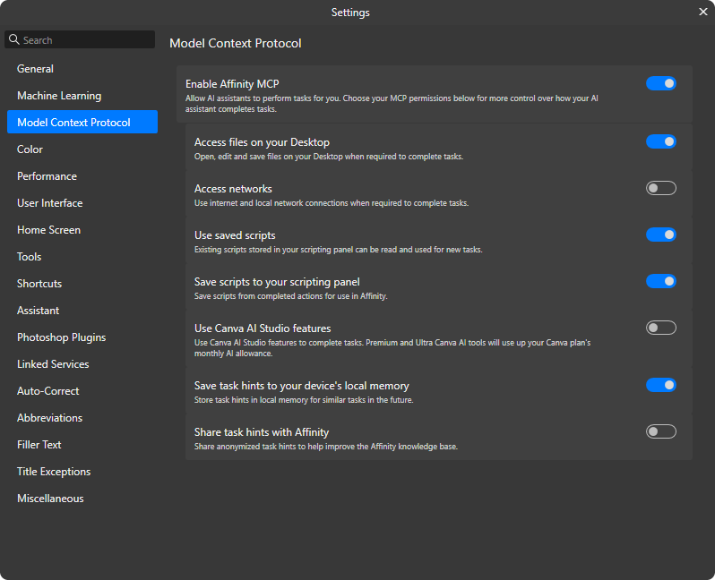

<p align="center">
  
</p>

<h1 align="center">Affinity MCP</h1>

<p align="center">让 AI 助手帮你操作 Affinity</p>
<p align="center"><a href="README.md">English</a> | 简体中文</p>
<p align="center">
  <a href="#开始使用">开始使用</a> ·
  <a href="#可以帮你做什么">可以帮你做什么</a> ·
  <a href="#隐私与条款">隐私与条款</a>
</p>

## 开始使用

准备好 **Affinity by Canva**、**Node.js 24.20+**，以及支持插件的 **Codex、ZCode 或 Claude Code**。Affinity 和 AI 助手需要在同一台电脑上运行。

### 1. 启用 MCP

打开 Affinity 的 **设置 → Model Context Protocol**，开启 **Enable Affinity MCP**，即可启用本机连接。

<details>
<summary>查看设置截图与可选权限</summary>



默认地址是 `http://localhost:6767/sse`。其它开关按任务需要开启，不必为了连接全部打开。

| 想做什么 | 对应开关与范围 |
| --- | --- |
| 打开、编辑或保存桌面文件 | **Access files on your Desktop**；只允许桌面范围，不是整盘访问。 |
| 使用已有脚本 | **Use saved scripts**。 |
| 保存脚本到面板 | **Save scripts to your scripting panel**。 |
| 保存本地任务提示 | **Save task hints to your device's local memory**。 |
| 让脚本发起 HTTP 请求 | **Access networks**；关闭它不影响 MCP 连接。 |
| 使用 Canva AI | **Use Canva AI Studio features**；Premium 和 Ultra 工具会消耗套餐的月度 AI 额度。 |
| 分享匿名任务提示 | **Share task hints with Affinity**；是否分享由你决定。 |

</details>

<a id="安装"></a>

### 2. 安装插件

**Codex**：在插件市场添加 `Paloexiz/Affinity-MCP`，安装 **Affinity MCP**。也可以在终端运行：

```shell
codex plugin marketplace add Paloexiz/Affinity-MCP
codex plugin add affinity-mcp@affinity-mcp
```

<details>
<summary>Claude Code</summary>

在终端添加市场并安装插件：

```shell
claude plugin marketplace add https://github.com/Paloexiz/Affinity-MCP.git
claude plugin install affinity-mcp@affinity-mcp
```

</details>

<details>
<summary>ZCode</summary>

打开任意工作区，进入 **设置 → 插件 → 创建 → 添加插件市场**，填入 `Paloexiz/Affinity-MCP`，然后在个人市场安装 **affinity-mcp**。也可以添加本地仓库目录。

</details>

请安装完整插件，MCP 服务会自动注册；单独安装 Skill 无法连接。

### 3. 发送第一个请求

在 AI 助手中说：

> 连接 Affinity，列出打开的文档，先不要修改。

## 可以帮你做什么

<a id="目前支持的功能"></a>

| 常见任务 | 可以交给助手的工作 |
| --- | --- |
| 编辑文字 | 创建艺术字或框架文本，修改内容、字体、字号和段落格式，链接文本框。 |
| 整理图层 | 查看、选择、重命名、移动图层，调整锁定和可见性。 |
| 调整版式 | 对齐对象、调整大小、设置页边距，处理基础形状、填充和描边。 |
| 保存与导出 | 保存、重开原生文档，导出 PNG、JPEG、SVG、PDF 或 WebP。 |

连接成功后，告诉助手要处理的文档、对象和期望结果。例如：

> 把选中的文本框左对齐，保持字号不变。

具体可做的操作取决于 Affinity 提供的接口、当前对象和权限，见[操作说明](skills/affinity-mcp/SKILL.md#supported-operations)和[已验证案例](skills/affinity-mcp/references/sdk-verified.md#version-boundaries)。

<a id="不支持或尚未验证的功能"></a>

### 使用前了解

- **关闭前先保存。** 已测异步关闭路径会在无提示情况下丢弃未保存内容，不能依赖保存提示。
- **取消文本框链接不等于恢复原文。** 已测双框场景中，合并全文留在源框，目标框变空。
- **排版要看实际效果。** 中文标点、混合格式和溢出都需要检查；艺术字与框架文本应按排版需求选择。[文字与标点说明](skills/affinity-mcp/references/sdk-verified.md#text-tool-choice-and-refit)
- **导出文件也要检查。** 基础格式导出通过不代表出血、多页、字体嵌入或自定义尺寸都已验证。[导出范围](skills/affinity-mcp/references/sdk-verified.md#verified-file-and-export-workflow)
- **超时后先查看文档。** 操作可能已经执行，确认实际状态后再重试。

<details>
<summary>还有哪些限制？</summary>

Affinity 界面的功能不一定都能通过 MCP 操作。自定义中文标点悬挂规则和文本框内垂直对齐尚无已验证的 SDK 设置路线；默认画笔创建和异步文件复制仍有失败记录。复杂文本链、高级选区及其它未测参数也不能视为已验证。

完整说明及对应案例见 [SDK reference](skills/affinity-mcp/references/sdk-verified.md)；连接、权限和脚本问题见[排错说明](skills/affinity-mcp/references/scripting-pitfalls.md)。

</details>

## 常见问题

| 遇到的问题 | 先检查什么 |
| --- | --- |
| 连接不上 | Affinity 是否打开、MCP 开关是否启用、`node` 是否在 `PATH` 中可用。`node --version` 需达到 24.20，建议 24.21+。工具列出不代表已连接。 |
| 工具出现两份 | 停用其它重复提供 Affinity 工具的插件或 MCP 配置。 |
| 更新后仍使用旧内容 | 刷新市场并更新插件，再打开新任务或重启会话。 |
| 文件操作被拒绝 | 确认已开启桌面文件权限，且目标文件位于允许的桌面范围内。 |

<details>
<summary>怎样更新插件？</summary>

在客户端刷新市场，再更新或重新安装。Codex CLI：

```shell
codex plugin marketplace upgrade affinity-mcp
codex plugin add affinity-mcp@affinity-mcp
```

Claude Code：

```shell
claude plugin marketplace update affinity-mcp
claude plugin update affinity-mcp@affinity-mcp
```

ZCode 刷新个人市场后更新插件。更新后打开新任务或重启会话，避免继续使用旧工具和 Skill。

版本变化见[中文更新日志](CHANGELOG.zh-cn.md)（[English](CHANGELOG.md)）。

</details>

<a id="检查真实安装连接"></a>
<details>
<summary>进阶：检查真实安装连接</summary>

保持 Affinity 打开并启用 MCP，在插件安装目录运行：

```shell
node skills/affinity-mcp/scripts/affinity-mcp-smoke.mjs --plugin-root "<absolute-plugin-root>" --config codex
```

将 `<absolute-plugin-root>` 换成确定的安装目录绝对路径；Claude Code / ZCode 使用 `--config shared`。

检查器核对该副本的清单与代理版本，发现在线工具并读取 SDK preamble，不执行文档脚本，也不修改文档、设置、提示或脚本库。它不会自动选择缓存副本。通过只证明指定配置能够连接，不证明客户端界面实际加载了该副本，也不证明文档操作有效。

</details>

## 隐私与条款

插件默认在本机连接 Affinity，但返回 AI 客户端的文档内容和预览可能发送给其模型提供者。使用前请阅读[隐私政策](PRIVACY.zh-cn.md)和[服务条款](TERMS.zh-cn.md)。

这是由 [Paloexiz](https://github.com/Paloexiz) 维护的社区项目，并非 OpenAI、Z.ai、Anthropic、Canva 或 Affinity 官方产品。遇到问题可到[项目 Issues](https://github.com/Paloexiz/Affinity-MCP/issues)反馈；这是公开渠道，请先移除敏感信息。

## 项目资料与致谢

开发渠道和交付规则见[版本说明](docs/versioning.md)。

插件布局参考 [Superpowers](https://github.com/obra/superpowers)；ZCode 通过其[Claude Code 插件兼容能力](https://zcode.z.ai/cn/docs/plugin)复用插件格式。Claude Code 集成参考其[插件规范](https://code.claude.com/docs/en/plugins-reference)和[市场规范](https://code.claude.com/docs/en/plugin-marketplaces)。

代理和 Skill 来自 [deba33/codex-plugins-by-deba33](https://github.com/deba33/codex-plugins-by-deba33)，来源提交为 Paloexiz fork 的 `9f2c2db`。原 MIT 许可及署名保留在 [LICENSE.upstream](LICENSE.upstream) 和 [NOTICE](NOTICE)，本仓库使用 [MIT 许可](LICENSE)。
