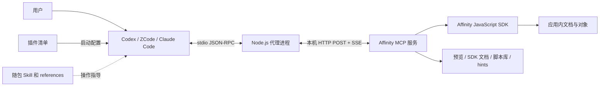
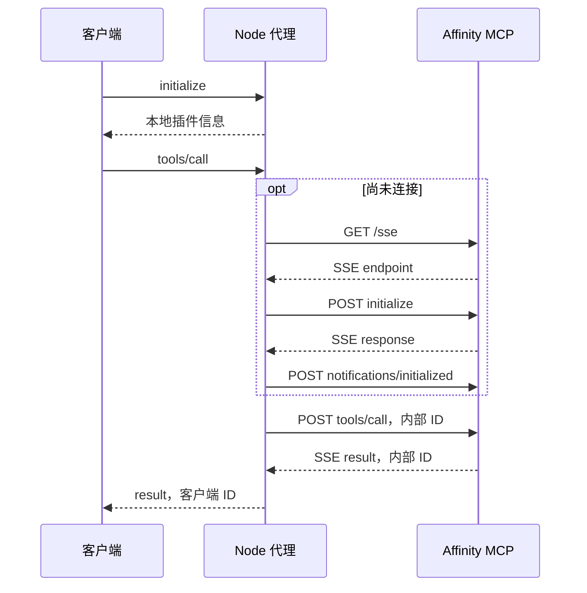

# Affinity MCP 架构说明

本页以仓库中的[代理源码](../skills/affinity-mcp/scripts/affinity-mcp-proxy.mjs)和插件清单为依据；当前插件标识 `0.5.4`。工作区改动不等于已发布新版本；SDK 操作在不同构建上的差异见 [SDK 索引](sdk/README.md)。

## 目标和边界

本仓库提供一个插件，让 Codex、ZCode、Claude Code 经本机的 Node.js 代理访问 Affinity 的 MCP 服务。代理负责传输和消息转发；执行脚本、操作文档、生成预览由 Affinity 应用完成；随包 Skill 向 Agent 提供操作指导。仓库不自己实现文本或版面引擎，也没有逐一实现每个 SDK 方法。依据见[仓库说明](../README.md)、[代理实现](../skills/affinity-mcp/scripts/affinity-mcp-proxy.mjs)和 [Skill](../skills/affinity-mcp/SKILL.md)。

图中的代理是独立进程；Affinity MCP 服务和 SDK 由外部应用提供。Skill 不参与消息转发，代理也不会据它强制校验脚本内容。

## 仓库构成

| 文件或目录 | 职责 | 不属于它的职责 |
| --- | --- | --- |
| [`.agents/plugins/marketplace.json`](../.agents/plugins/marketplace.json) | Codex 单插件索引，来源 `./` | 不定义 SDK 能力 |
| [`.codex-plugin/plugin.json`](../.codex-plugin/plugin.json) | Codex 插件元数据、Skill 路径、内联 MCP 启动配置 | 不控制 Affinity 权限 |
| [`.claude-plugin/`](../.claude-plugin/plugin.json) 与 [市场索引](../.claude-plugin/marketplace.json) | Claude Code / ZCode 共用插件描述与版本 | 不保证客户端实际已刷新缓存 |
| [`.mcp.json`](../.mcp.json) | Claude Code / ZCode 共用 stdio 启动配置 | 不把 60 秒客户端配置传入代理的内部计时器 |
| [隐私政策](../PRIVACY.zh-cn.md)与[服务条款](../TERMS.zh-cn.md)及英文版 | 随安装树提供数据处理说明、使用约定和公开联系入口；Codex 清单、Claude Code 清单与 ZCode 市场条目各声明对应的 HTTPS 政策链接 | 不替代第三方政策，也不增加 MIT 许可限制；清单 URL 的线上可用性须在发布后核验 |
| [`skills/affinity-mcp/scripts/affinity-mcp-proxy.mjs`](../skills/affinity-mcp/scripts/affinity-mcp-proxy.mjs) | stdin 解析、请求路由、SSE 连接、响应关联、错误转发 | 不校验目标文档、不回滚 SDK 操作、不保存操作结果 |
| [`scripts/affinity-mcp-proxy.test.mjs`](../scripts/affinity-mcp-proxy.test.mjs) | 模拟服务上的进程边界和打包配置回归 | 不证明真实 SDK 操作有效 |
| [`scripts/check-version.mjs`](../scripts/check-version.mjs) 与[回归](../scripts/check-version.test.mjs) | 在显式指定的渠道下检查版本格式、现行声明是否同步，以及可选的 Git 基准增量检查 | 不决定产品影响级别，不发布版本，也不验证宿主缓存或安装渠道切换 |
| [`scripts/check-links.mjs`](../scripts/check-links.mjs)、[回归](../scripts/check-links.test.mjs)及[生产文件清单](../scripts/production-files.json) | 核对本地 Markdown/HTML 引用、锚点、忽略规则、生产允许文件来源和安装引用 | 不访问外部链接，不替代真实 ZIP/安装验收、任意 Markdown 解析或隐私语义审查 |
| [`skills/affinity-mcp/scripts/affinity-mcp-smoke.mjs`](../skills/affinity-mcp/scripts/affinity-mcp-smoke.mjs) | 指定安装副本之后，做在线发现并检查 preamble 连接 | 不自动查找缓存版本，也不验证宿主 UI 加载的副本或 SDK 文档操作 |
| [`skills/affinity-mcp/`](../skills/affinity-mcp/SKILL.md) | 操作入口、授权边界、样本与结果验收指导 | 不替代应用当前版本的运行证据 |
| [`inspection-preview.mjs`](../skills/affinity-mcp/scripts/inspection-preview.mjs) | 用已导出 PNG 和同次核验的几何生成独立 SVG 检查图，标出完整 Bleed、Trim 与启用的 Margin，以棋盘底显示原图透明区；仅用 Node 内置模块 | 不连接 Affinity、不写工程、不改代理；不是原生辅助线开关或自动印前验收，SVG 的本地渲染与宿主交付另行验证 |
| `docs/` 中的公共技术文档与根目录 `AGENTS.md` | 架构、版本记录、脱敏技术摘要及维护约定 | 仅在开发分支维护，不进入生产安装树；不能引用被 Git 忽略的内容 |
| `assets/sdk-evidence/` | 开发文档和检查图回归使用的公开合成图片、几何夹具，含三框接排、界面文字转换及资源包失真对照 | 不属于运行依赖，不进入 `main` 或生产安装包；真实 SDK 样本的适用范围见各证据页，图片不能推导完整功能通过 |
| 本地内部归档 | 原始问题、个人工作材料和实验原始输出 | 保持忽略，不作为 docs 的内容依赖或证据引用 |

本仓库采用单上下文，规模不大；文档按职责分开，代码仍然只有一个代理脚本。详见[领域约定](agents/domain.md)。

政策链接按各宿主的约定分别声明，但都指向同一套随包文件：

| 宿主 | 政策字段与位置 | 规范与边界 |
| --- | --- | --- |
| Codex | `.codex-plugin/plugin.json` 的 `interface.privacyPolicyURL`、`interface.termsOfServiceURL`；支持入口为 `interface.supportURL` | [官方清单字段](https://developers.openai.com/plugins/deploy/submission#listing-metadata)；实际展示由宿主或目录决定。 |
| Claude Code | `.claude-plugin/plugin.json` 顶层的 `privacyPolicyUrl`、`termsOfServiceUrl`、`supportUrl` | [Anthropic 目录字段](https://code.claude.com/docs/en/plugins/manifest-reference#directory-listing-fields)供目录展示，运行时忽略；仅放在插件清单中。`2.1.281` 起校验器认可这些字段，旧版会告警并令严格校验失败。 |
| ZCode | `.claude-plugin/marketplace.json` 的插件条目中使用 `privacyPolicy`、`termsOfService` | ZCode 在目录层读取展示信息，其[解析实现](https://github.com/zai-org/zcode/blob/aac4755666d09fdcd70272fcf063c077a639015f/apps/zcode-cli/packages/adapters/src/plugins/marketplace.ts#L2293)及[目录层决策](https://github.com/zai-org/zcode/blob/aac4755666d09fdcd70272fcf063c077a639015f/docs/adr/0001-store-listing-in-marketplace-catalog.md)与插件清单字段分开；README 继续提供通用入口。 |

共用市场保留 ZCode 的图标、翻译和政策扩展。Claude Code 把这些目录扩展视为未知字段并忽略：普通校验可以带告警通过，`--strict` 会把告警视为失败；这不等于政策文件缺失或运行时不兼容。[未知字段与校验规则](https://code.claude.com/docs/en/plugins/manifest-reference#unrecognized-fields)。

运行代理和连接检查器都在 `skills/affinity-mcp/scripts/`；根目录 `scripts/` 保留代理测试、版本检查和文档 hooks 等维护工具。插件只支持完整安装：Skill 虽带运行资源，MCP 注册与启动仍由 Plugin 清单负责，单独安装 Skill 不会注册服务。安装方法见[安装说明](../README.zh-cn.md#安装)和 [Skill 入口](../skills/affinity-mcp/SKILL.md)。

正式交付时，先在 `develop` 转正并推送，再从该确切提交按[生产文件允许清单](versioning.md#production-content)把生产内容同步到 `main`；开发维护资源留在 `develop`，不能整个复制过去。渠道和交付边界见[版本规则](versioning.md)。

## 连接和一次请求

1. 客户端按插件清单启动 `node skills/affinity-mcp/scripts/affinity-mcp-proxy.mjs`。Codex 以插件目录为 `cwd`；共用配置通过 `${CLAUDE_PLUGIN_ROOT}` 定位脚本。参见 [Codex 清单](../.codex-plugin/plugin.json)和[共用配置](../.mcp.json)。
2. `initialize` 和 `ping` 由代理在本地直接回答，只有 `tools/list` 或 `tools/call` 才会触发与 Affinity 的惰性连接；所以 initialize/ping 成功不能证明应用已在线。
3. 代理向 `${AFFINITY_MCP_BASE_URL}/sse` 发起 GET，读取其中的 `endpoint` 事件，只接受与配置基址同源的 POST 地址；随后向该地址发送 `initialize`，检查必需结果字段和选定的上游协议，校验通过才发送 `notifications/initialized`。
4. 每次向上游发请求，代理都分配新的内部 ID，记在内存的 `pending` Map；请求经 HTTP POST 发出，结果从 SSE 返回。代理先区分上游的请求、通知和响应；只有有效响应能按内部 ID 完成对应 Promise，再用客户端原来的请求 ID 返回结果。上游请求用另一套 ID 关联，不会消费同 ID 的 `pending` 记录。
5. `tools/call` 的工具名、参数和结果都原样转发，结果中可能包含文本、图像和 `isError`。代理不会把脚本输出解读成业务成功，也没有串行执行队列，客户端并发请求会重叠等待。以上五步的实现见[代理实现](../skills/affinity-mcp/scripts/affinity-mcp-proxy.mjs)。

客户端默认换行分隔 JSON，也兼容旧的 `Content-Length` 帧。首次输入先把 c/C 开头的候选头暂存；只有完整 CRLF 头存在独立、非负十进制 `Content-Length` 行（其他字段名或值中的同名文本不算），才进入旧帧模式，body 长度也只从该字段读取。确认允许大小写、`Content-Type` 前置和附加头字段；候选出现非头行或完整头缺合法长度时，原缓冲按换行 JSON 处理，确认后输入/输出模式固定。输入是合法旧帧头但 body 未收全时，代理继续等待，不当作坏 JSON。日志输出到 stderr。MCP `2025-11-25` 标准 stdio 用换行分隔；当前代理对 Affinity 仍用独立 SSE 端点加 POST 的旧式 HTTP+SSE，不能因配置协议日期较新就称其为 Streamable HTTP 实现。[MCP transport 规范](https://modelcontextprotocol.io/specification/2025-11-25/basic/transports)。

SSE 流按 LF、CRLF 或裸 CR 分行：遇 CR 立即结束当前行，紧随的 LF（即使落在下一分片）只作同一行结束符被消费；解码按 UTF-8 流式进行。非空行以第一个冒号拆字段名和值，值首单个 ASCII 空格移除；无冒号时整行作字段名、值为空。字段名精确匹配 `event` 或 `data`：裸 `event` 清空事件类型，裸 `data` 和 `data:` 都追加换行；注释和其他字段忽略。多行 `data` 用换行连接；只有空行触发事件派发，EOF 不补发未以空行结束的事件。参见 [WHATWG 事件流格式](https://html.spec.whatwg.org/multipage/server-sent-events.html#parsing-an-event-stream)。

## 协议表面和故障行为

下表“实现依据”列的“代理实现”均指[代理实现](../skills/affinity-mcp/scripts/affinity-mcp-proxy.mjs)；MCP 规范链接逐行给出。

| 请求或事件 | 当前行为 | 实现依据 |
| --- | --- | --- |
| `initialize` | 客户端侧支持 `2025-11-25`。客户端请求其他字符串时，代理返回自己支持的版本，由客户端决定是否继续；protocolVersion 缺失或不是字符串时返回 `-32602`。这一步只在本地完成协商，不会连接 Affinity。 | 代理实现的 CLIENT_PROTOCOL_VERSION 与 initialize 分支；[MCP 版本协商](https://modelcontextprotocol.io/specification/2025-11-25/basic/lifecycle#version-negotiation) |
| `tools/list` | 提供 cursor 时它必须是字符串，可以为空串；成功时原样转发结果和 `nextCursor`。未提供 cursor 时，发现失败返回 11 个静态备用工具；提供 cursor 时失败直接报错。 | 代理实现 |
| `tools/call` | name 必须是字符串；arguments 若提供必须是对象，省略时按空对象处理。校验通过后才确保连接。已经提交的调用不会自动重放。 | 代理实现 |
| `resources/list`、`prompts/list` | 都返回空列表；SDK 文档需经由工具读取。 | 代理实现 |
| 通知 | 客户端通知只要具有合法的 JSON-RPC 外壳且没有 id，就被忽略：不产生响应，也不触发连接；上游的 `notifications/initialized` 由代理自行发送。 | 代理实现 |
| 上游请求/通知 | 上游 `ping` 由代理本地回复；未知请求返回 `-32601`，无效 params 返回 `-32602`；合法通知忽略。回复通过 POST 发出，不阻塞 SSE 上的业务响应，也不创建 pending。 | 代理实现；[MCP 双向 ping](https://modelcontextprotocol.io/specification/2025-11-25/basic/utilities/ping) |
| 上游消息校验 | 收到无效 JSON-RPC 外壳，或命中 pending 的响应本身无效时，按 SSE 协议故障处理，拒绝当前连接上的全部 pending。响应必须恰好含一个对象 result 或一个合法 error，不能在没有结果时以成功结束。 | 代理实现；[MCP 消息规范](https://modelcontextprotocol.io/specification/2025-11-25/basic/index) |
| 上游初始化结果 | protocolVersion 须为字符串；capabilities 与 serverInfo 须为非 null、非数组对象；serverInfo.name/version 须为字符串；返回协议须等于配置选定的上游版本。失败归入 upstream/initialize/not_submitted，代理关闭连接，不发送 initialized，也不进入业务；无 cursor 的发现仍按既有规则降级。 | 代理实现；[MCP InitializeResult](https://modelcontextprotocol.io/specification/2025-11-25/schema#initializeresult) |
| 断开 SSE | 代理清理连接标记并拒绝所有 pending。初始化通知结束前，它会再确认本次连接仍然有效，确认失败就不标记 connected；之后独立的新请求可以重新建立连接。 | 代理实现 |
| stdin EOF、SIGINT、SIGTERM | 关闭连接、清理 pending，然后退出。 | 代理实现 |
| 迟到响应 | 响应 ID 已不在 pending 中就不再交付；代理也不会因为这个响应去取消应用里已经在跑的脚本。 | 代理实现 |
| 未知方法或坏输入 | 未知方法返回 `-32601`，坏 JSON 返回 `-32700`，无效 JSON-RPC 或请求 ID 返回 `-32600`。ID 只接受字符串或整数；显式 null 不按通知处理，非法 ID 不回显。请求的 params 若提供，必须是非 null、非数组的对象；params 或方法参数类型错误时，用原 ID 返回 `-32602`，且不连接上游。 | 代理实现；[MCP 消息规范](https://modelcontextprotocol.io/specification/2025-11-25/basic/index) |
| 传输/上游异常 | 统一包装为 `-32603`。错误消息和 error.data 区分 connect、endpoint、post、response、sse、upstream 阶段，保留 cause/outcome；已知方法时带 method。本地输入和未知方法错误不保证带 data。只有 connect 失败才建议检查应用和 MCP 设置。 | 代理实现的 failure 与 handleMessage |

备用列表只用于帮助发现工具；真正的能力目录以在线的 `tools/list` 和 SDK topics 为准。`initialize`、`ping` 和备用列表都不能证明连接健康。`tools/list` 路由见上表。

客户端支持版本与 `AFFINITY_MCP_PROTOCOL_VERSION` 是两个设置：后者决定代理发给 Affinity、并愿接受的上游初始化版本，客户端请求覆盖不了；两段协商可用不同版本。上游选其他版本不算服务器违规，只是代理没有接受该版本的兼容依据，会明确失败。空 capabilities 和扩展字段仍允许，serverInfo 不限厂商或版本格式。这里只校验必需字段，声明版本不等于认证全部可选 MCP 能力。[MCP 版本协商](https://modelcontextprotocol.io/specification/2025-11-25/basic/lifecycle#version-negotiation)。

## 时间边界与恢复

| 等待阶段 | 配置或实现值 | 范围 |
| --- | --- | --- |
| 首次 GET `/sse` 返回 | 30,000 ms | Fetch 响应返回后清除此计时器；不是整个 SSE 流寿命 |
| 等待 endpoint | 50 次 × 100 ms | 约 5 秒的轮询窗口 |
| 上游响应 pending | AFFINITY_MCP_REQUEST_TIMEOUT_MS，默认 30,000 ms | 从注册 pending 开始；POST 未结束时归因 post 阶段，否则为 response 阶段 |
| 单个 POST | 同一环境配置 | 与连接 AbortSignal 合并，也用于 initialize 请求及 initialized 通知 |
| 共用客户端 `.mcp.json` | `timeoutMs: 60000` | 客户端配置，不替换代理环境值；Codex 内联配置未设此字段 |

依据是[代理实现](../skills/affinity-mcp/scripts/affinity-mcp-proxy.mjs)中的 REQUEST_TIMEOUT_MS、request 和 post，以及[共用配置](../.mcp.json)。该值允许 100～300000 的整数（毫秒），未设置时用默认值；空值、非整数和越界值启动即报错退出，stderr 不打印配置值。修改环境变量后需重启代理。初始 SSE 建连和等待 endpoint 是独立阶段，可串接或重叠，不是整次调用共用一个 deadline，客户端超时预算要相应覆盖。

请求结果以先到达的终止事件为准：SSE 成功或上游错误可以在 POST 还在等待时完成请求；之后即使 POST 报错，该错误仍会被观察到，但不改变已经交付的结果。等待超时会移除 pending，此后的迟到成功或错误一律丢弃，不补发第二次响应。SSE 解析失败或断线会拒绝当前 pending，后续新请求可以重新连接。

工具一旦尝试提交，之后的传输失败或上游错误都保守记为 outcome=unknown，此时应先读回文档的实际状态。not_submitted 只表示本次业务工具没有提交（例如建连或初始化失败），不能据此推断历史操作状态。代理不会取消或回滚应用里已在运行的脚本。

上游请求的回复如果 POST 失败，代理会关闭它所属的连接，并拒绝尚未完成的 pending；已经交付的结果不会再补一次响应。异步失败只影响发出回复时的那条连接，旧连接上的拒绝不会清理新连接里的请求。

连接失败、HTTP 错误、脚本错误、权限拒绝和工具超时需要分别定位。超时或断线后，应用可能已改动文档，而代理没有回滚机制；应先重读 preamble 和文档身份，确认实际状态，再决定后续。[Skill 恢复要求](../skills/affinity-mcp/SKILL.md)、[版本样本的错误边界](sdk/3.3.0.4850.md#errors)。

## 运行和状态归属

| 状态 | 所有者及寿命 |
| --- | --- |
| 连接、endpoint、内部请求 ID、pending | 代理进程内存；关闭连接会清理 pending/endpoint，不把请求落盘 |
| 当前文档、spread、节点、撤销历史、保存状态 | Affinity 应用；网络断开不证明操作已取消 |
| 当前工具目录、安装 Skill 副本、输出截断和图像附件处理 | 客户端/宿主；须与仓库内容分别核对 |
| 文件访问、脚本网络、脚本库、hint/AI 权限 | Affinity 设置及用户授权；不是代理传输本身提供的权限 |

依据见[代理内存字段及关闭逻辑](../skills/affinity-mcp/scripts/affinity-mcp-proxy.mjs)、[运行边界 reference](../skills/affinity-mcp/references/scripting-pitfalls.md)和[权限说明](../skills/affinity-mcp/SKILL.md)。代理拒绝重定向并检查 endpoint 同源；但源码既无认证配置，也无脚本授权判定，默认部署是同机 localhost。把 BASE_URL 改成远程地址需另行评估，不能据本页得出远程部署可用。

## 验证覆盖与维护入口

开发参与平台包括 Windows、macOS 和 Linux；维护工具不能依赖个人机器路径，也不能只提供单一平台命令。[文档 hooks](hooks.md)采用跨平台 Node.js 实现，分别提供 PowerShell 和 POSIX 入口；其三平台测试与 Affinity SDK 的应用平台证据分开记录。

版本检查只用 Node.js 内置模块，无额外依赖。静态模式核对三份清单和代理两处声明；开发渠道还要求文档四处身份完整一致。开发树若采用正式格式且有 `docs/`，也须同样完整同步；生产树可省略该目录。

CHANGELOG 的三级现行版本标题必须恰好匹配一个条目：待交付候选在“未发布”下，已交付版本在日期分组里。对已交付的开发版本和正式候选，检查器还核对日期日历有效性，但不确认实际发布事件。为只读核验旧树，检查器保留旧式日志标题的稳定版本检查；当前日志用日期分组和对应语言分类。

静态模式不调用 Git。显式 `--from` 或 `--stable` 的增量模式要求 Git 2.45 及以上，解析本地 commit、核对基准声明并检查数字递增。Git 调用以参数数组传入并带全局 `--no-lazy-fetch`：部分克隆缺对象即失败，不隐式取远端对象；旧版 Git 不支持该选项也直接失败。检查失败不输出原始错误，也不自动 fetch、升级 Git 或更改引用。

没有待交付内容时，省略英文 `Unreleased` / 中文“未发布”分组。检查器仍兼容历史空分组、中文标题和旧式 `[Unreleased]`，但拒绝重复分组。回归在开发与正式渠道下验证省略该分组的 LF/CRLF 日志及实际 CLI，并继续拒绝缺失日期、无效日期和重复版本条目。

根目录 `CHANGELOG.md` 用英文，`CHANGELOG.zh-cn.md` 用简体中文。中文日志存在时，检查器对照两份日志的日期、版本、分类和条目数量结构，任一处不一致即明确失败。它不比较翻译语义；历史快照只有一份日志时也不拒绝只读核验。双语回归覆盖两种渠道、CRLF 中文日志及版本、历史日期、分类和条目遗漏。安装夹具随完整插件保留两份日志。

正式格式回归还覆盖三种情况：开发树文档声明不一致、缺少部分必需文档、生产树整体省略 `docs/`。这样 `develop` 转正与随后同步的生产树可复用同一套正式检查，不放松版本、日期或增量约束。

测试覆盖序号超过 9、跳号或倒退、切换目标后重置、基准缺失或不一致、单处版本遗漏。无远端临时仓库通过实际 CLI 验证未提交稳定候选的静态与增量检查，也验证缺失、版本错误、重复或无效日期日志条目会失败。历史基准只允许旧根目录或新 Skill 目录有一个代理入口，零个或两个都失败；当前文件系统仍只读新入口。两种历史布局都校验全部五处身份，并通过真实部分克隆确认缺 blob 时失败且不发生 fetch，pack 与本地对象集合保持不变。这些检查不能替代业务影响判断、实际交付证据或真实安装验收。检查方法见[两类检查](versioning.md#两类检查)。下文回归的实现均见[测试实现](../scripts/affinity-mcp-proxy.test.mjs)。

当前的测试命令是 `node scripts/affinity-mcp-proxy.test.mjs`。测试用本地模拟服务和真实子进程，覆盖两种帧格式、UTF-8 字节级拆分、同次输入多条消息、坏 JSON 恢复、通知不回包、分页、文本与图像透传、HTTP 503、配置默认值/边界/非法值、连接与 endpoint 等待、初始化与通知等待、POST 与 SSE 延迟竞态、迟到响应不重复、异常 SSE、断开不重放与重连、EOF、两段握手的版本与清单一致性，以及含空格、中文和字面美元符号的安装路径。安装目录身份按解析符号链接后的真实路径比较。关闭后检查完整响应集合和残留缓冲，避免漏掉迟到或额外回包。

上游边界的回归还覆盖同 ID 的 ping 与未知请求、通知保持静默、回复 POST 延迟或失败、旧连接回复结束后的重连，以及结果缺失或冲突、非法 error 形状。扩展错误字段会继续作为上游错误诊断透传。回复内容要等模拟服务完整读取并记录 HTTP body 之后再核对；业务 SSE 返回不能代替这个完成事件。在普通换行入口的测试里，还会扣住回复 body，确认业务 stdout 先到，再放行并核对恰好一条回复；最小超时用例只复用完成事件，不增加这道门闩。

回复 POST 的两种终态顺序分别受控。第一种：完整 body 已到但 HTTP 响应未放行时，业务 SSE 必须先完成；随后放行 503，并等代理关闭所属 SSE 才发下一个请求。第二种：不发业务成功 SSE，让回复的 HTTP 503 先终止请求，再核对原因和后续重连。旧连接迟到处理仍保留，但定时器不能证明跨连接处理顺序精确。等子进程关闭、服务停止收新请求、已接收 HTTP handler 排空后，测试按连接和 ID 排序，结构化比较上游回复完整集合；不限 JSON 字段顺序，但拒绝漏答、重复答、通知误答和未知 ID。失败清理同样释放门闩并等子进程退出。

初始化结果的回归在两种 stdio 格式下，覆盖必需字段缺失、类型非法和返回协议不匹配；两套启动配置与 timeout 边界都使用有代表性的负例。并发调用共用一个失败握手时，测试会检查：没有 initialized，也没有业务提交；固定诊断不回显非法字段；之后的独立调用能重新连接。合法的最小字段、空 capabilities 和扩展信息仍然可以通过。两套连接检查配置都会拒绝持续的坏握手，也会拒绝“发现降级后重新连接、读到合法 preamble”的假在线结果。

SSE 回归覆盖 LF、裸 CR、跨读取边界的 CRLF、混合行结束符、默认及显式 message 事件、多行 data、中文 UTF-8 字节级拆分，以及 EOF 丢弃未完成事件。字段回归通过普通 CLI 检查裸 `event`、`event:` 和 `event: ` 重置后的响应、注释与相似字段名被忽略，以及只移除一个 ASCII 空格。透明 JSON 解析观察器把解析委托给原生实现并记录专属样本，验证裸 `data`、`data:`、`data: ` 各自追加一个换行。末尾 CR 后的 LF 要等初始化 POST 才发送，以验证 CR 能及时派发 endpoint；中文后半段字节要等观察器确认同一解码实例收到前半段才继续发送。观察器只委托原生解码并报告输入，不改变生产解析逻辑；已有并发、超时和恢复用例仍通过普通 CLI 验证。

客户端输入的回归在两种帧格式下逐条比较完整响应，覆盖非法的 ID、params、工具名或 arguments、cursor，也覆盖合法的字符串或整数 ID、扩展字段、通知静默和后续请求恢复。被拒绝的输入不会连接或提交到上游；空串 cursor 会原样透传，失败时也不降级；省略 arguments 时仍按对象处理。

初始模式识别和旧帧长度读取还覆盖这些情况：第一条输入是 c/C 开头的坏 JSON、出现像头部的坏输入后如何恢复、旧头的大小写、顺序、水平空白与附加字段、附加字段名称或值中的同名长度文本、字段值内的 U+2028/U+2029，以及头名称、冒号、长度、CR/LF、空行和中文 body 内部的分片。测试 IPC 观察器要等实际 stdin handler 收到前一段后才放行后一段；它检查完整回包格式、回包次数以及上游连接为零，同时保留普通直接 CLI 的对照。

[可选连接检查](../skills/affinity-mcp/scripts/affinity-mcp-smoke.mjs)独立于普通回归，使用选定安装副本的 Codex 配置或共用启动配置，只执行初始化、分页发现和读取 preamble。检查器核对完整的 Plugin 清单、代理入口和版本一致性，拒绝不受支持的代理路径和缺少清单的单独 Skill。回归夹具包含两套清单、市场索引、Skill/references/运行脚本、清单资源和署名文件，从夹具的检查器入口在另一工作目录执行；夹具核对插件版本和代理文件的精确 hash。

分页 cursor 作为不透明字符串原样传递，空字符串也继续分页；只有 nextCursor 缺失才结束，非字符串或重复 cursor 明确失败。检查器复用既有 stderr 降级诊断，并在子进程关闭后检查。RPC 错误、工具错误、内容缺失/不匹配、超时及清理异常都不能通过。Node 版本按所选启动命令、环境和工作目录取得；插件版本与代理 hash 分开记录。没有应用构建或平台时保留空值，不把插件身份当应用身份。模拟服务还覆盖两种配置下的空串分页、非法或重复 cursor、错误、降级、超时和清理分支。真实命令与边界见 [README](../README.zh-cn.md#检查真实安装连接)及 [MCP 分页规范](https://modelcontextprotocol.io/specification/2025-11-25/server/utilities/pagination)。

连接检查器用 Node 的 `import.meta.main` 区分“直接执行”和“作为模块导入”。回归通过真实 CLI 验证两种配置成功时的 JSON、无效参数的非零退出，以及导入时不运行检查。Windows 还覆盖指向同一入口的 namespaced 路径，避免因路径字符串不同而静默退出。[检查器](../skills/affinity-mcp/scripts/affinity-mcp-smoke.mjs)、[Node.js 24 模块入口](https://nodejs.org/docs/latest-v24.x/api/esm.html#importmetamain)。

被声明为文本的 preamble 内容块必须提供字符串 `text`。只要有一个文本块的 text 不是字符串，检查即失败，即使其他块已含全部 preamble 标记。合法文本块按顺序拼接，也允许其他内容类型存在。模拟回归在两种配置下覆盖数组、对象、数字、布尔值、null、text 缺失及它们与合法文本混合的负例；同时验证多个文本块与图像混合的合法内容。非法数组样本还通过临时测试副本的 PID 和退出记录，确认 EOF 后正常退出、无残留子进程。[测试](../scripts/affinity-mcp-proxy.test.mjs)、[MCP TextContent 定义](https://modelcontextprotocol.io/specification/2025-11-25/schema)。

这些测试和夹具不能证明真实的 Affinity SDK 功能，也不等于真实市场安装或宿主加载验收；它们没有穷尽备用列表、30 秒 SSE 建连可能遇到的所有网络故障、权限配置或全部协议坏输入。SDK 证据由[构建记录](sdk/README.md)承担，新场景见[验证指南](sdk/verification.md)；不要把模拟服务通过写成“已适配全部功能”。

以后如果改动连接策略、工具转发语义或部署边界，要同时更新本页和对应测试。确实做出新的长期架构选择时，再新增 ADR，记录当时的原因、选项和后果。
