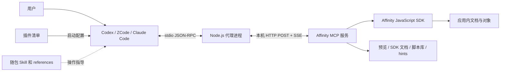
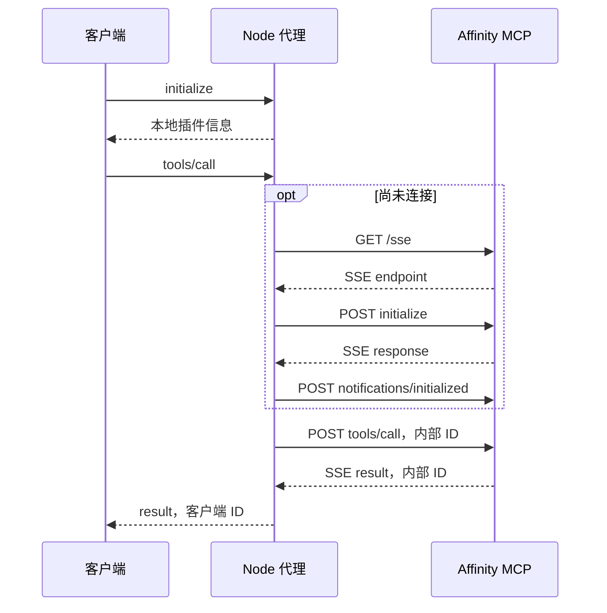

# Affinity MCP 架构说明

实现依据为仓库中的[代理源码](../skills/affinity-mcp/scripts/affinity-mcp-proxy.mjs)和清单，插件标识 `0.4.0-dev.1`；工作树改动不代表已发布新版本。SDK操作的构建差异单独记录在[SDK索引](sdk/README.md)。

## 目标和边界

本仓库提供一个插件，让 Codex、ZCode、Claude Code 经由本机 Node.js 代理访问 Affinity 的 MCP 服务。代理提供传输和消息转发，Affinity 应用执行脚本、操作文档并生成预览；随包 Skill 提供 Agent 的操作指导。仓库没有单独实现文本引擎、版面引擎或每一个 SDK 方法。[依据：仓库说明](../README.md)、[代理实现](../skills/affinity-mcp/scripts/affinity-mcp-proxy.mjs)、[Skill](../skills/affinity-mcp/SKILL.md)。

图中代理是独立进程；Affinity MCP 服务与 SDK 属于外部应用能力。Skill 不在消息转发路径中，不会在代理内部强制验证脚本内容。[代理实现](../skills/affinity-mcp/scripts/affinity-mcp-proxy.mjs)。

## 仓库构成

| 文件或目录 | 职责 | 不应归到它的职责 |
| --- | --- | --- |
| [`.agents/plugins/marketplace.json`](../.agents/plugins/marketplace.json) | Codex 单插件索引，来源 `./` | 不定义 SDK 能力 |
| [`.codex-plugin/plugin.json`](../.codex-plugin/plugin.json) | Codex 插件元数据、Skill 路径、内联 MCP 启动配置 | 不控制 Affinity 权限 |
| [`.claude-plugin/`](../.claude-plugin/plugin.json) 与 [市场索引](../.claude-plugin/marketplace.json) | Claude Code / ZCode 共用插件描述与版本 | 不保证客户端实际已刷新缓存 |
| [`.mcp.json`](../.mcp.json) | Claude Code / ZCode 共用 stdio 启动配置 | 不把 60 秒客户端配置传入代理的内部计时器 |
| [`skills/affinity-mcp/scripts/affinity-mcp-proxy.mjs`](../skills/affinity-mcp/scripts/affinity-mcp-proxy.mjs) | stdin 解析、请求路由、SSE 连接、响应关联、错误转发 | 不校验目标文档、不回滚 SDK 操作、不保存操作结果 |
| [`scripts/affinity-mcp-proxy.test.mjs`](../scripts/affinity-mcp-proxy.test.mjs) | 模拟服务上的进程边界和打包配置回归 | 不证明真实 SDK 操作有效 |
| [`skills/affinity-mcp/scripts/affinity-mcp-smoke.mjs`](../skills/affinity-mcp/scripts/affinity-mcp-smoke.mjs) | 显式指定安装副本后的在线发现及preamble连接检查 | 不自动找缓存版本，不验证宿主UI加载的副本或SDK文档操作 |
| [`skills/affinity-mcp/`](../skills/affinity-mcp/SKILL.md) | 操作入口、授权边界、样本与结果验收指导 | 不替代应用当前版本的运行证据 |
| `docs/` 中的公共技术文档与根目录 `AGENTS.md` | 架构、版本记录、脱敏技术摘要及维护约定 | 随仓库维护；不能引用被 Git 忽略的内容，本地专用说明与插件交付范围分别核对 |
| 本地内部归档 | 原始问题、个人工作材料和实验原始输出 | 保持忽略，不作为 docs 的内容依赖或证据引用 |

这是单上下文的小型仓库；文档按职责分开，代码仍是一个代理脚本。[领域约定](agents/domain.md)。

运行代理和连接检查器位于 `skills/affinity-mcp/scripts/`；根 `scripts/` 保留代理测试与文档 hooks 等仓库维护工具。仅支持完整 Plugin 安装；Skill 包含运行资源，MCP 注册与启动仍由 Plugin 清单负责，单独安装 Skill 不会注册服务。[安装说明](../README.zh-cn.md#安装)、[Skill 入口](../skills/affinity-mcp/SKILL.md)。

## 连接和一次请求

1. 客户端按清单启动 `node skills/affinity-mcp/scripts/affinity-mcp-proxy.mjs`。Codex 使用插件目录作为 `cwd`；共用配置用 `${CLAUDE_PLUGIN_ROOT}` 定位脚本。[Codex 清单](../.codex-plugin/plugin.json)、[共用配置](../.mcp.json)。
2. 代理在本地回答客户端的 `initialize`、`ping`。只有 `tools/list` 或 `tools/call` 才触发对 Affinity 的惰性连接。因此 initialize/ping 成功不能证明应用在线。[代理实现](../skills/affinity-mcp/scripts/affinity-mcp-proxy.mjs)。
3. 代理 GET `${AFFINITY_MCP_BASE_URL}/sse`，读取 `endpoint` 事件；只接受与配置基址相同 origin 的 POST 地址。随后向该地址发送 `initialize`，校验必需结果字段及所选上游协议，成功后才发送 `notifications/initialized`。[代理实现](../skills/affinity-mcp/scripts/affinity-mcp-proxy.mjs)。
4. 每次上游请求分配新的内部 ID，并放入内存 `pending` Map。请求经 HTTP POST 发出，结果从 SSE 返回；代理先区分上游请求、通知和响应，只有有效响应能按内部 ID 完成 Promise，再用原客户端请求 ID 返回。上游发来的请求使用独立的 ID 关联，不消费同 ID 的 `pending`。[代理实现](../skills/affinity-mcp/scripts/affinity-mcp-proxy.mjs)。
5. `tools/call` 的工具名、参数和结果被转发，结果可含文本、图像和 `isError`。代理不把脚本输出转换成业务成功结论；没有串行执行队列，客户端并发到来的请求可重叠等待。[代理实现](../skills/affinity-mcp/scripts/affinity-mcp-proxy.mjs)。

客户端侧默认使用换行分隔 JSON；还兼容旧 `Content-Length` 帧。首次输入暂存 c/C 开头的候选头，完整 CRLF 头中存在独立的非负十进制 `Content-Length` 行时才确认旧帧模式，允许大小写变化、`Content-Type` 在前及附加头字段。候选出现非头行或完整头缺少合法长度时，原缓冲按换行 JSON 处理；确认后的输入/输出模式固定。每帧 body 的字节长度只从 CRLF 分隔的独立 `Content-Length` 字段行读取，其他字段名称或值中的同名文本不参与长度选择。若输入恰是合法旧帧头但 body 尚未完整，则继续等待，无法同时将它解释为坏 JSON。日志走 stderr。[代理实现](../skills/affinity-mcp/scripts/affinity-mcp-proxy.mjs)。MCP `2025-11-25` 的标准 stdio 使用换行分隔；当前代理对 Affinity 使用的是独立 SSE 与 POST endpoint 的旧 HTTP+SSE 形态，不能因为配置中的协议日期较新就称为 Streamable HTTP 实现。[MCP transport 规范](https://modelcontextprotocol.io/specification/2025-11-25/basic/transports)。

SSE 按 LF、CRLF 或裸 CR 分行；CR 立即结束一行，跨分片紧随其后的一个 LF 只作为同一行结束符消费。UTF-8 使用流式解码，非空行按第一个冒号拆分字段名和值，仅移除值开头的一个 ASCII 空格；无冒号行使用完整字段名和空值。字段名精确匹配 `event` 或 `data`：裸 `event` 清空事件类型，裸 `data` 与 `data:` 均追加一个换行；注释和其他字段忽略。多行 `data` 以换行连接；只有空行触发事件派发，EOF 不补派发未以空行结束的事件。[代理实现](../skills/affinity-mcp/scripts/affinity-mcp-proxy.mjs)、[WHATWG 事件流格式](https://html.spec.whatwg.org/multipage/server-sent-events.html#parsing-an-event-stream)。

## 协议表面和故障行为

| 请求或事件 | 当前行为 | 实现依据 |
| --- | --- | --- |
| `initialize` | 客户端侧支持`2025-11-25`；请求其他字符串时返回此支持版本，由客户端判断是否继续；缺失或非字符串protocolVersion返回`-32602`。只处理本地协商，不连接Affinity | [代理实现](../skills/affinity-mcp/scripts/affinity-mcp-proxy.mjs)的CLIENT_PROTOCOL_VERSION与initialize分支；[MCP版本协商](https://modelcontextprotocol.io/specification/2025-11-25/basic/lifecycle#version-negotiation) |
| `tools/list` | cursor 若提供须为字符串，可为空串；成功时原样转发结果与 `nextCursor`。未提供 cursor 的发现失败返回 11 个静态备用工具；提供 cursor 时失败直接报错 | [代理实现](../skills/affinity-mcp/scripts/affinity-mcp-proxy.mjs) |
| `tools/call` | name 须为字符串，arguments 若提供须为对象，省略时用空对象；校验后确保连接。已提交调用不会自动重放 | [代理实现](../skills/affinity-mcp/scripts/affinity-mcp-proxy.mjs) |
| `resources/list`、`prompts/list` | 返回空列表；SDK 文档通过工具读取 | [代理实现](../skills/affinity-mcp/scripts/affinity-mcp-proxy.mjs) |
| 通知 | 客户端具有合法 JSON-RPC 外壳且没有 id 的通知被忽略，不产生响应或连接；上游 `notifications/initialized` 由代理自己发送 | [代理实现](../skills/affinity-mcp/scripts/affinity-mcp-proxy.mjs) |
| 上游请求/通知 | 上游 `ping` 由代理本地回复，未知请求返回 `-32601`，无效 params 返回 `-32602`；合法通知忽略。回复经 POST 发出，不阻塞 SSE 业务响应，也不创建 pending | [代理实现](../skills/affinity-mcp/scripts/affinity-mcp-proxy.mjs)；[MCP 双向 ping](https://modelcontextprotocol.io/specification/2025-11-25/basic/utilities/ping) |
| 上游消息校验 | 无效 JSON-RPC 外壳或命中 pending 的无效响应按 SSE 协议故障处理，拒绝当前连接全部 pending；响应必须恰有对象 result 或合法 error，不能以缺失结果成功结束请求 | [代理实现](../skills/affinity-mcp/scripts/affinity-mcp-proxy.mjs)；[MCP 消息规范](https://modelcontextprotocol.io/specification/2025-11-25/basic/index) |
| 上游初始化结果 | protocolVersion须为字符串，capabilities及serverInfo须为非null、非数组对象，serverInfo.name/version须为字符串；返回协议须等于配置选择的上游版本。失败归因upstream/initialize/not_submitted，关闭连接且不发送initialized或业务；无cursor发现仍按既有规则降级 | [代理实现](../skills/affinity-mcp/scripts/affinity-mcp-proxy.mjs)；[MCP InitializeResult](https://modelcontextprotocol.io/specification/2025-11-25/schema#initializeresult) |
| 断开 SSE | 清理连接标记并拒绝所有 pending 请求；初始化通知结束前再次确认本次连接仍有效，失败不标记connected；后续独立新请求可重新连接 | [代理实现](../skills/affinity-mcp/scripts/affinity-mcp-proxy.mjs) |
| stdin EOF、SIGINT、SIGTERM | 关闭连接、清理 pending，再退出 | [代理实现](../skills/affinity-mcp/scripts/affinity-mcp-proxy.mjs) |
| 迟到响应 | 对应 ID 已不在 pending 时不再交付；不据此取消应用中的脚本 | [代理实现](../skills/affinity-mcp/scripts/affinity-mcp-proxy.mjs) |
| 未知方法或坏输入 | 未知方法 `-32601`；坏 JSON `-32700`；无效 JSON-RPC 或请求 ID `-32600`。ID 只接受字符串或整数，显式 null 不算通知，非法 ID 不回显。请求 params 若提供须为非 null、非数组对象；params 或方法参数类型错误返回原 ID 的 `-32602`，不连接上游 | [代理实现](../skills/affinity-mcp/scripts/affinity-mcp-proxy.mjs)；[MCP 消息规范](https://modelcontextprotocol.io/specification/2025-11-25/basic/index) |
| 传输/上游异常 | 包装为 `-32603`，消息与error.data区分connect/endpoint/post/response/sse/upstream，保留cause/outcome，已知方法时包含method；本地输入/未知方法错误不保证有data。只有connect失败建议检查应用和MCP设置 | [代理实现](../skills/affinity-mcp/scripts/affinity-mcp-proxy.mjs)的failure与handleMessage |

备用列表只能帮助工具发现；真正的能力目录以在线 `tools/list` 和 SDK topics 为准。`initialize`、`ping`、备用列表均不构成连接健康证明。[同上 tools/list 路由](../skills/affinity-mcp/scripts/affinity-mcp-proxy.mjs)。

客户端侧的支持版本与`AFFINITY_MCP_PROTOCOL_VERSION`分开：后者选择代理发给Affinity并接受的上游初始化版本，客户端请求不会覆盖它。两段协商可以使用不同版本；上游另选版本本身不代表服务器违规，但代理未建立接受其他版本的兼容依据，会明确失败。空capabilities及扩展字段仍允许，不限制serverInfo为特定厂商或版本格式；此处只校验必需字段，声明版本不等于对所有可选MCP能力的全面认证。[MCP版本协商](https://modelcontextprotocol.io/specification/2025-11-25/basic/lifecycle#version-negotiation)。

## 时间边界与恢复

| 等待阶段 | 配置或实现值 | 范围 |
| --- | --- | --- |
| 首次 GET `/sse` 返回 | 30,000 ms | Fetch 响应返回后清除此计时器；不是整个 SSE 流寿命 |
| 等待 endpoint | 50 次 × 100 ms | 约 5 秒的轮询窗口 |
| 上游响应 pending | AFFINITY_MCP_REQUEST_TIMEOUT_MS，默认30,000 ms | 从注册pending开始；POST未结束时归因post阶段，否则response阶段 |
| 单个 POST | 同一环境配置 | 与连接AbortSignal合并，也用于initialize请求及initialized通知 |
| 共用客户端 `.mcp.json` | `timeoutMs: 60000` | 客户端配置，不替换代理环境值；Codex内联配置未设此字段 |

依据：[代理实现](../skills/affinity-mcp/scripts/affinity-mcp-proxy.mjs)的REQUEST_TIMEOUT_MS、request与post、[共用配置](../.mcp.json)。允许100～300000毫秒整数，未设置使用默认值；空值、非整数和越界值在启动时报错退出，stderr不打印配置值。更改环境需重启代理。初始SSE建连和endpoint等待仍独立，各阶段串接/重叠，不是整次调用deadline；客户端预算须相应覆盖。

请求结果以先到的终止事件为准：SSE成功/上游错误可以在POST仍等候时完成请求，随后POST错误仍被观察但不改变已交付结果。等待超时移除pending，迟到成功/错误仍丢弃，不补第二次响应。SSE解析失败/断线拒绝当前pending，后续新请求可重连。工具尝试提交后的传输失败或上游错误保守标outcome=unknown，先读回文档实际状态；not_submitted仅表示本次业务工具未提交（例如建连/初始化失败），不推断历史操作状态。代理不取消或回滚应用内脚本。

上游请求的回复 POST 失败会关闭所属连接并拒绝尚未完成的 pending；已交付结果不补第二次响应。异步失败只作用于发出回复时的连接，旧连接的拒绝不会清理新连接的请求。[代理实现](../skills/affinity-mcp/scripts/affinity-mcp-proxy.mjs)。

连接失败、HTTP 错误、脚本错误、权限拒绝、工具超时分别定位。超时或断线后应用可能已经改变文档，代理没有回滚机制；先重读 preamble 和文档身份、检查实际状态，再决定后续动作。[Skill 恢复要求](../skills/affinity-mcp/SKILL.md)、[版本样本的错误边界](sdk/3.3.0.4850.md#errors)。

## 运行和状态归属

| 状态 | 所有者及寿命 |
| --- | --- |
| 连接、endpoint、内部请求 ID、pending | 代理进程内存；关闭连接会清理 pending/endpoint，不把请求落盘 |
| 当前文档、spread、节点、撤销历史、保存状态 | Affinity 应用；网络断开不证明操作已取消 |
| 当前工具目录、安装 Skill 副本、输出截断和图像附件处理 | 客户端/宿主；须与仓库内容分别核对 |
| 文件访问、脚本网络、脚本库、hint/AI 权限 | Affinity 设置及用户授权；不是代理传输本身提供的权限 |

依据：[代理内存字段及关闭逻辑](../skills/affinity-mcp/scripts/affinity-mcp-proxy.mjs)、[运行边界 reference](../skills/affinity-mcp/references/scripting-pitfalls.md)、[权限说明](../skills/affinity-mcp/SKILL.md)。代理拒绝重定向并检查 endpoint 同源，但源码没有认证配置或脚本授权判定；默认部署是同机 localhost。将 BASE_URL 改成远程地址需要另行评估，不能从当前文档推导远程部署保证。[代理实现](../skills/affinity-mcp/scripts/affinity-mcp-proxy.mjs)。

## 验证覆盖与维护入口

仓库开发参与平台包括 Windows、macOS、Linux；维护工具不得依赖个人机器路径或只提供单一平台命令。仓库 [文档 hooks](hooks.md) 使用跨平台 Node.js 实现及独立的 PowerShell/POSIX 启动入口，其三平台测试与 Affinity SDK 的应用平台证据分别记录。

现有测试命令为 `node scripts/affinity-mcp-proxy.test.mjs`。本地模拟服务与真实子进程覆盖两种帧格式、UTF-8字符内部拆分、同次输入多条消息、坏JSON恢复、通知无回包、分页、文本/图像透传、HTTP503、配置默认/上下界/非法值、连接/endpoint/初始化与通知等待、延迟POST/SSE竞态、迟到成功与错误不重复响应、异常SSE、断开不重放及后续重连、EOF、版本一致性和含空格、中文和字面美元符号的安装路径。安装目录身份按解析符号链接后的真实路径比较。关闭后检查完整响应集合与残留缓冲，避免遗漏迟到或额外回包。[测试实现](../scripts/affinity-mcp-proxy.test.mjs)。

上游边界回归还覆盖同 ID 的 ping/未知请求、通知静默、回复 POST 延迟与失败、旧连接回复结束后的重连，以及缺失/冲突结果和非法 error 形状；扩展错误字段继续透传为上游错误诊断。[测试实现](../scripts/affinity-mcp-proxy.test.mjs)。

初始化结果回归在两种stdio格式下覆盖必需字段缺失/非法类型及返回协议不匹配；两套启动配置和timeout边界使用代表负例。并发调用共用一个失败握手，检查零initialized/业务提交、固定诊断不回显非法字段，以及后续独立调用重新连接。合法最小字段、空capabilities和扩展信息继续通过。两套连接检查配置均拒绝持续坏握手，也拒绝发现降级后重新连接并读到合法preamble的假在线结果。[测试实现](../scripts/affinity-mcp-proxy.test.mjs)。

SSE 回归覆盖 LF、裸 CR、跨读取的 CRLF、混合行结束符、默认及显式 message 事件、多行 data、中文 UTF-8 字节内部拆分，以及 EOF 未完成事件丢弃。字段回归通过普通 CLI 检查裸 `event`、`event:`、`event: ` 重置后的响应、注释和相似字段名忽略、仅一个 ASCII 空格可移除；透明 JSON 解析观察器委托原生解析并记录专属样本输入，验证裸 `data`、`data:`、`data: ` 各追加一个换行。末尾 CR 后的 LF 要等初始化 POST 才发送，以验证 CR 本身及时派发 endpoint；中文后半字节要等测试观察器确认同一解码实例已收到前半段才发送。观察器只委托原生解码并报告输入，不改变生产解析逻辑；既有并发、超时和恢复用例仍通过普通 CLI 验证。[测试实现](../scripts/affinity-mcp-proxy.test.mjs)。

客户端输入回归在两种帧格式下逐条比较完整响应，覆盖非法 ID、params、工具名/arguments、cursor，以及合法字符串/整数 ID、扩展字段、通知静默和后续请求恢复。被拒绝输入不连接或提交上游；空串 cursor 透传且失败不降级，省略 arguments 仍为对象。[测试实现](../scripts/affinity-mcp-proxy.test.mjs)。

初始模式识别和旧帧长度读取还覆盖首条 c/C 坏 JSON、头样坏输入后的恢复、旧头大小写/顺序/水平空白/附加字段、附加字段名称或值中的同名长度文本、字段值内的 U+2028/U+2029，以及头名称、冒号、长度、CR/LF、空行和中文 body 内的分片。测试 IPC 观察器在实际 stdin handler 收到前段后才放行后段，检查完整回包格式、次数与零上游连接；普通直接 CLI 对照仍保留。[测试实现](../scripts/affinity-mcp-proxy.test.mjs)。

[可选连接检查](../skills/affinity-mcp/scripts/affinity-mcp-smoke.mjs)独立于普通回归，使用选定安装副本的Codex或共用启动配置，仅执行初始化、分页发现和读取preamble。检查器核对完整 Plugin 清单、代理入口和版本一致性，拒绝不受支持的代理路径或缺少清单的单独 Skill。回归夹具包含两套清单、市场索引、Skill/references/运行脚本、清单资源及署名文件，并从夹具的检查器入口以其他工作目录执行；夹具核对插件版本和代理文件的精确 hash。这些夹具不等于真实市场安装或宿主加载验收。分页 cursor 作为不透明字符串原样传递，空字符串也继续分页；只有缺失 nextCursor 才结束，非字符串或重复 cursor 明确失败。复用既有stderr降级诊断，在子进程关闭后检查，备用列表不能证明在线；RPC/工具错误、缺失或不匹配的内容、超时及清理异常不能通过。Node版本按所选启动命令、环境和工作目录取得，插件版本与代理hash分别记录；未取得应用构建/平台时保留空值，不将插件身份当作应用身份。现有模拟服务还覆盖两种配置的空字符串分页、非法/重复 cursor、错误、降级、超时和清理分支；真实使用命令及边界见[README](../README.zh-cn.md#检查真实安装连接)、[MCP 分页规范](https://modelcontextprotocol.io/specification/2025-11-25/server/utilities/pagination)。

连接检查器以 Node 的 `import.meta.main` 区分直接执行与模块导入。回归通过真实 CLI 验证两种配置的成功 JSON、无效参数的非零退出，以及导入不运行检查；Windows 另覆盖指向同一入口的 namespaced 路径，避免路径字符串差异导致静默退出。[检查器](../skills/affinity-mcp/scripts/affinity-mcp-smoke.mjs)、[测试](../scripts/affinity-mcp-proxy.test.mjs)、[Node.js 24 模块入口](https://nodejs.org/docs/latest-v24.x/api/esm.html#importmetamain)。

preamble 中声明为文本的内容块必须提供字符串 `text`；任一非字符串文本块都会失败，即使其他块含有全部 preamble 标记。合法文本块按顺序拼接，允许同时存在其他内容类型。模拟回归覆盖两种配置下的数组、对象、数字、布尔值、null、缺失文本及与合法文本混合的负例，同时验证多文本与图像混合的合法内容。非法数组样本还通过临时测试副本的 PID 和退出记录确认 EOF 正常退出，没有残留子进程。[检查器](../skills/affinity-mcp/scripts/affinity-mcp-smoke.mjs)、[测试](../scripts/affinity-mcp-proxy.test.mjs)、[MCP TextContent 定义](https://modelcontextprotocol.io/specification/2025-11-25/schema)。

测试不证明真实Affinity SDK功能，也未穷尽备用列表、30秒SSE建连的所有网络故障、权限配置和全部协议坏输入。SDK证据由[构建记录](sdk/README.md)承担，新场景见[验证指南](sdk/verification.md)，不把模拟服务通过写成“已适配全部功能”。

后续改变连接策略、工具转发语义或部署边界时，更新本页和对应测试；若实际作出新的长期架构选择，再新增 ADR 记录当时的原因、选项和后果。本页未追认历史作者未记录的设计动机。
