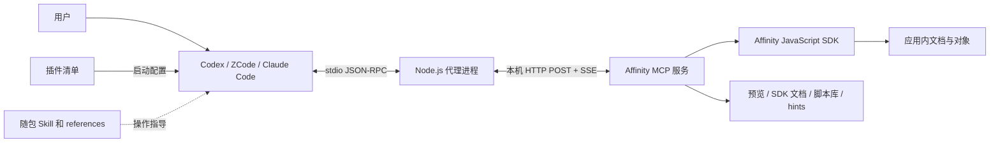
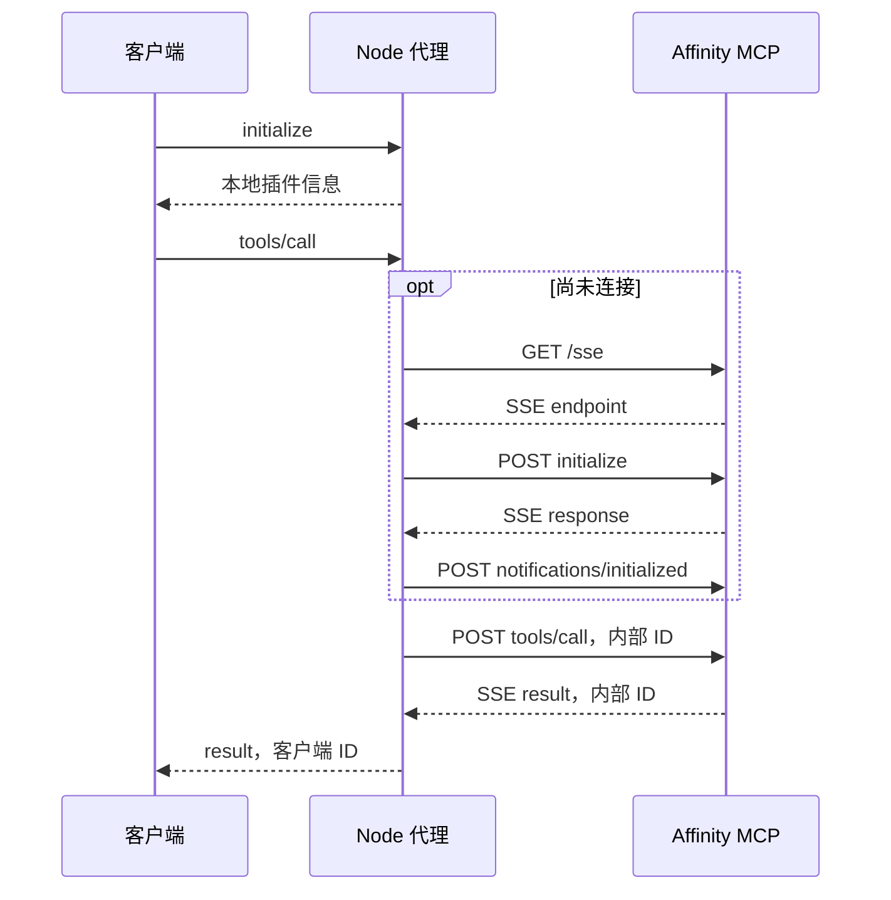

# Affinity MCP 架构说明

实现依据为仓库中的[代理源码](../skills/affinity-mcp/scripts/affinity-mcp-proxy.mjs)和清单，插件标识 `0.5.4-dev.3`；工作树改动不代表已发布新版本。SDK操作的构建差异单独记录在[SDK索引](sdk/README.md)。

## 目标和边界

本仓库提供一个插件，让 Codex、ZCode、Claude Code 经由本机 Node.js 代理访问 Affinity 的 MCP 服务。代理提供传输和消息转发，Affinity 应用执行脚本、操作文档并生成预览；随包 Skill 提供 Agent 的操作指导。仓库没有单独实现文本引擎、版面引擎或每一个 SDK 方法。[依据：仓库说明](../README.md)、[代理实现](../skills/affinity-mcp/scripts/affinity-mcp-proxy.mjs)、[Skill](../skills/affinity-mcp/SKILL.md)。

图中代理是独立进程；Affinity MCP 服务与 SDK 属于外部应用能力。Skill 不在消息转发路径中，不会在代理内部强制验证脚本内容。[代理实现](../skills/affinity-mcp/scripts/affinity-mcp-proxy.mjs)。

## 仓库构成

| 文件或目录 | 职责 | 不应归到它的职责 |
| --- | --- | --- |
| [`.agents/plugins/marketplace.json`](../.agents/plugins/marketplace.json) | Codex 单插件索引，来源 `./` | 不定义 SDK 能力 |
| [`.codex-plugin/plugin.json`](../.codex-plugin/plugin.json) | Codex 插件元数据、Skill 路径、内联 MCP 启动配置 | 不控制 Affinity 权限 |
| [`.claude-plugin/`](../.claude-plugin/plugin.json) 与 [市场索引](../.claude-plugin/marketplace.json) | Claude Code / ZCode 共用插件描述与版本 | 不保证客户端实际已刷新缓存 |
| [`.mcp.json`](../.mcp.json) | Claude Code / ZCode 共用 stdio 启动配置 | 不把 60 秒客户端配置传入代理的内部计时器 |
| [隐私政策](../PRIVACY.zh-cn.md)与[服务条款](../TERMS.zh-cn.md)及英文版 | 随安装树提供的数据处理说明、使用约定及公开联系入口；Codex 清单、Claude Code 清单和 ZCode 市场条目各声明对应的 HTTPS 政策链接 | 不替代第三方政策，不增加 MIT 软件许可限制；清单 URL 的线上可用性须在发布后另行核验 |
| [`skills/affinity-mcp/scripts/affinity-mcp-proxy.mjs`](../skills/affinity-mcp/scripts/affinity-mcp-proxy.mjs) | stdin 解析、请求路由、SSE 连接、响应关联、错误转发 | 不校验目标文档、不回滚 SDK 操作、不保存操作结果 |
| [`scripts/affinity-mcp-proxy.test.mjs`](../scripts/affinity-mcp-proxy.test.mjs) | 模拟服务上的进程边界和打包配置回归 | 不证明真实 SDK 操作有效 |
| [`scripts/check-version.mjs`](../scripts/check-version.mjs) 与[回归](../scripts/check-version.test.mjs) | 显式渠道下的版本格式、现行声明同步及可选 Git 基准增量检查 | 不决定产品影响级别，不发布版本，不验证宿主缓存或安装渠道切换 |
| [`scripts/check-delivery.mjs`](../scripts/check-delivery.mjs)、[CI 入口](../scripts/ci.mjs)与对应回归 | 检查普通批次、末提交声明及 skip；独立候选入口校验同 core 转正、严格日期差异、最近转正来源撤回和只读控制证据 | 不以 PR merge SHA 代替 head 历史；启用候选模式须有固定控制根及平台配置；检查本身不写生产 |
| [`scripts/check-links.mjs`](../scripts/check-links.mjs)、[回归](../scripts/check-links.test.mjs)及[生产文件清单](../scripts/release/production-files.json) | 核对仓库本地 Markdown/HTML 引用、锚点、忽略规则、生产允许文件来源与安装引用 | 不访问外部链接，不替代真实 ZIP/安装验收、任意 Markdown 解析或隐私语义审查 |
| [CLI 的归档模式](../scripts/release.mjs)、[生产树与清单](../scripts/release/production.mjs)、[ZIP 配方](../scripts/release/archive.mjs)及[安装模拟](../scripts/release/install.mjs) | 从固定 Git blob/mode 生成三项可复现归档；闭环比较 source、ZIP、manifest、tree 与显式候选校验值，执行实际包内两配置模拟 | 归档模式不自动转正，不写远端或使用生产凭据；模拟不证明真实 SDK、市场安装或宿主加载 |
| [发布控制协议](../scripts/release/control.mjs)、[针对性审批](../scripts/release/control-actions.mjs)、[GitHub 边界](../scripts/release/github.mjs)及[回归](../scripts/release/control.test.mjs) | 验证固定根下的完整数据历史、排他 owner、单个写入意图和永久候选撤销；批准后的 guard 与恢复只追加控制数据 | 不创建平台保护，不以任务取消或 token 到期代替请求终态；模块通过不代表平台启用 |
| [发布证据](../scripts/release/evidence.mjs)、[正常发布](../scripts/release/publication.mjs)、[App 凭据](../scripts/release/app.mjs)及[回归](../scripts/release/publication.test.mjs) | 核对准确 push attempt、可读保护配置、同次运行交接和独审记录；保存 receipt 后依次写入生产目标并读回 | 不代替人工 Environment 批准、配置启用验收或独审真实性 |
| [工作流步骤](../scripts/release/workflow.mjs)与[受控入口](../scripts/release/entry.mjs) | 分离当前工具与旧 source，传递准确制品和安装回执；直接 dispatch 明确失败后短时切默认分支，立即恢复并读回 | 不把本地模拟、YAML 或入口启动当作真实三平台、平台保护和发布验收 |
| [补缺恢复](../scripts/release/recovery.mjs)与[回归](../scripts/release/recovery.test.mjs) | 核对已交付 P、原 receipt/配方/历史与新检查，复用正确目标，只补 tag、草稿和附件等后续步骤 | 不改写 main 或旧 receipt，不代替控制恢复，不把平台读取失败当作原 CI 过期 |
| [`skills/affinity-mcp/scripts/affinity-mcp-smoke.mjs`](../skills/affinity-mcp/scripts/affinity-mcp-smoke.mjs) | 显式指定安装副本后的在线发现及preamble连接检查 | 不自动找缓存版本，不验证宿主UI加载的副本或SDK文档操作 |
| [`skills/affinity-mcp/`](../skills/affinity-mcp/SKILL.md) | 操作入口、授权边界、样本与结果验收指导 | 不替代应用当前版本的运行证据 |
| [`inspection-preview.mjs`](../skills/affinity-mcp/scripts/inspection-preview.mjs) | 使用已导出 PNG 和同次核验的几何生成独立 SVG 检查图，标出完整 Bleed、Trim 与启用的 Margin，以棋盘底显示原图透明区域；仅使用 Node 内置模块 | 不连接 Affinity、不写工程或修改代理；不是原生辅助线开关或自动印前验收，SVG 的本地图像渲染与宿主交付另行验证 |
| `docs/` 中的公共技术文档与根目录 `AGENTS.md` | 架构、版本记录、脱敏技术摘要及维护约定 | 仅在开发分支维护，不进入生产安装树；不能引用被 Git 忽略的内容 |
| `assets/sdk-evidence/` | 开发文档和检查图回归使用的公开合成图片、几何夹具；包括三框接排、界面文字转换及资源包失真对照 | 不属于运行依赖，不进入 `main` 或生产安装包；真实 SDK 样本的适用范围见各证据页，不能由图片推导完整功能通过 |
| 本地内部归档 | 原始问题、个人工作材料和实验原始输出 | 保持忽略，不作为 docs 的内容依赖或证据引用 |

这是单上下文的小型仓库；文档按职责分开，代码仍是一个代理脚本。[领域约定](agents/domain.md)。

政策链接按宿主约定分开放置，指向同一套随包文件：

| 宿主 | 政策字段与位置 | 规范与边界 |
| --- | --- | --- |
| Codex | `.codex-plugin/plugin.json` 的 `interface.privacyPolicyURL`、`interface.termsOfServiceURL`；支持入口为 `interface.supportURL` | [官方清单字段](https://developers.openai.com/plugins/deploy/submission#listing-metadata)；实际展示由宿主或目录决定。 |
| Claude Code | `.claude-plugin/plugin.json` 顶层的 `privacyPolicyUrl`、`termsOfServiceUrl`、`supportUrl` | [Anthropic 目录字段](https://code.claude.com/docs/en/plugins/manifest-reference#directory-listing-fields)供目录展示，Claude Code 运行时忽略；仅放在插件清单中。`2.1.281` 起校验器认可这些字段，旧版会告警并使严格校验失败。 |
| ZCode | `.claude-plugin/marketplace.json` 的插件条目中使用 `privacyPolicy`、`termsOfService` | ZCode 在目录层读取展示信息，其[解析实现](https://github.com/zai-org/zcode/blob/aac4755666d09fdcd70272fcf063c077a639015f/apps/zcode-cli/packages/adapters/src/plugins/marketplace.ts#L2293)及[目录层决策](https://github.com/zai-org/zcode/blob/aac4755666d09fdcd70272fcf063c077a639015f/docs/adr/0001-store-listing-in-marketplace-catalog.md)与插件清单字段分开；README 继续提供通用入口。 |

共用市场保留 ZCode 的图标、翻译和政策扩展。Claude Code 将这些目录扩展视为未知字段并忽略，普通校验可带告警通过，`--strict` 会将告警视为失败；不要把这一结果解释为政策文件缺失或运行时不兼容。[未知字段与校验规则](https://code.claude.com/docs/en/plugins/manifest-reference#unrecognized-fields)。

运行代理和连接检查器位于 `skills/affinity-mcp/scripts/`；根 `scripts/` 保留代理测试、版本检查与文档 hooks 等仓库维护工具。仅支持完整 Plugin 安装；Skill 包含运行资源，MCP 注册与启动仍由 Plugin 清单负责，单独安装 Skill 不会注册服务。[安装说明](../README.zh-cn.md#安装)、[Skill 入口](../skills/affinity-mcp/SKILL.md)。正式交付先在 `develop` 转正并推送，再从该确切提交按[生产文件允许清单](versioning.md#production-content)向 `main` 同步；开发维护资源留在 `develop`，不能整体复制资源目录。渠道与交付边界见[版本规则](versioning.md)。

## 连接和一次请求

1. 客户端按清单启动 `node skills/affinity-mcp/scripts/affinity-mcp-proxy.mjs`。Codex 使用插件目录作为 `cwd`；共用配置用 `${CLAUDE_PLUGIN_ROOT}` 定位脚本。[Codex 清单](../.codex-plugin/plugin.json)、[共用配置](../.mcp.json)。
2. 代理在本地回答客户端的 `initialize`、`ping`。只有 `tools/list` 或 `tools/call` 才触发对 Affinity 的惰性连接。因此 initialize/ping 成功不能证明应用在线。[代理实现](../skills/affinity-mcp/scripts/affinity-mcp-proxy.mjs)。
3. 代理 GET `${AFFINITY_MCP_BASE_URL}/sse`，读取 `endpoint` 事件；只接受与配置基址相同 origin 的 POST 地址。随后向该地址发送 `initialize`，校验必需结果字段及所选上游协议，成功后才发送 `notifications/initialized`。[代理实现](../skills/affinity-mcp/scripts/affinity-mcp-proxy.mjs)。
4. 每次上游请求分配新的内部 ID，并放入内存 `pending` Map。请求经 HTTP POST 发出，结果从 SSE 返回；代理先区分上游请求、通知和响应，只有有效响应能按内部 ID 完成 Promise，再用原客户端请求 ID 返回。上游发来的请求使用独立的 ID 关联，不消费同 ID 的 `pending`。[代理实现](../skills/affinity-mcp/scripts/affinity-mcp-proxy.mjs)。
5. `tools/call` 的工具名、参数和结果被转发，结果可含文本、图像和 `isError`。代理不把脚本输出转换成业务成功结论；没有串行执行队列，客户端并发到来的请求可重叠等待。[代理实现](../skills/affinity-mcp/scripts/affinity-mcp-proxy.mjs)。

客户端侧默认使用换行分隔 JSON；还兼容旧 `Content-Length` 帧。首次输入暂存 c/C 开头的候选头，完整 CRLF 头中存在独立的非负十进制 `Content-Length` 行时才确认旧帧模式，允许大小写变化、`Content-Type` 在前及附加头字段。候选出现非头行或完整头缺少合法长度时，原缓冲按换行 JSON 处理；确认后的输入/输出模式固定。每帧 body 的字节长度只从 CRLF 分隔的独立 `Content-Length` 字段行读取，其他字段名称或值中的同名文本不参与长度选择。若输入恰是合法旧帧头但 body 尚未完整，则继续等待，无法同时将它解释为坏 JSON。日志走 stderr。[代理实现](../skills/affinity-mcp/scripts/affinity-mcp-proxy.mjs)。MCP `2025-11-25` 的标准 stdio 使用换行分隔；当前代理对 Affinity 使用的是独立 SSE 与 POST endpoint 的旧 HTTP+SSE 形态，不能因为配置中的协议日期较新就称为 Streamable HTTP 实现。[MCP transport 规范](https://modelcontextprotocol.io/specification/2025-11-25/basic/transports)。

SSE 按 LF、CRLF 或裸 CR 分行；CR 立即结束一行，跨分片紧随其后的一个 LF 只作为同一行结束符消费。UTF-8 使用流式解码，非空行按第一个冒号拆分字段名和值，仅移除值开头的一个 ASCII 空格；无冒号行使用完整字段名和空值。字段名精确匹配 `event` 或 `data`：裸 `event` 清空事件类型，裸 `data` 与 `data:` 均追加一个换行；注释和其他字段忽略。多行 `data` 以换行连接；只有空行触发事件派发，EOF 不补派发未以空行结束的事件。[代理实现](../skills/affinity-mcp/scripts/affinity-mcp-proxy.mjs)、[WHATWG 事件流格式](https://html.spec.whatwg.org/multipage/server-sent-events.html#parsing-an-event-stream)。

## 协议表面和故障行为

| 请求或事件 | 当前行为 | 实现依据 |
| --- | --- | --- |
| `initialize` | 客户端侧支持`2025-11-25`；请求其他字符串时返回此支持版本，由客户端判断是否继续；缺失或非字符串protocolVersion返回`-32602`。只处理本地协商，不连接Affinity | [代理实现](../skills/affinity-mcp/scripts/affinity-mcp-proxy.mjs)的CLIENT_PROTOCOL_VERSION与initialize分支；[MCP版本协商](https://modelcontextprotocol.io/specification/2025-11-25/basic/lifecycle#version-negotiation) |
| `tools/list` | cursor 若提供须为字符串，可为空串；成功时原样转发结果与 `nextCursor`。未提供 cursor 的发现失败返回 11 个静态备用工具；提供 cursor 时失败直接报错 | [代理实现](../skills/affinity-mcp/scripts/affinity-mcp-proxy.mjs) |
| `tools/call` | name 须为字符串，arguments 若提供须为对象，省略时用空对象；校验后确保连接。已提交调用不会自动重放 | [代理实现](../skills/affinity-mcp/scripts/affinity-mcp-proxy.mjs) |
| `resources/list`、`prompts/list` | 返回空列表；SDK 文档通过工具读取 | [代理实现](../skills/affinity-mcp/scripts/affinity-mcp-proxy.mjs) |
| 通知 | 客户端具有合法 JSON-RPC 外壳且没有 id 的通知被忽略，不产生响应或连接；上游 `notifications/initialized` 由代理自己发送 | [代理实现](../skills/affinity-mcp/scripts/affinity-mcp-proxy.mjs) |
| 上游请求/通知 | 上游 `ping` 由代理本地回复，未知请求返回 `-32601`，无效 params 返回 `-32602`；合法通知忽略。回复经 POST 发出，不阻塞 SSE 业务响应，也不创建 pending | [代理实现](../skills/affinity-mcp/scripts/affinity-mcp-proxy.mjs)；[MCP 双向 ping](https://modelcontextprotocol.io/specification/2025-11-25/basic/utilities/ping) |
| 上游消息校验 | 无效 JSON-RPC 外壳或命中 pending 的无效响应按 SSE 协议故障处理，拒绝当前连接全部 pending；响应必须恰有对象 result 或合法 error，不能以缺失结果成功结束请求 | [代理实现](../skills/affinity-mcp/scripts/affinity-mcp-proxy.mjs)；[MCP 消息规范](https://modelcontextprotocol.io/specification/2025-11-25/basic/index) |
| 上游初始化结果 | protocolVersion须为字符串，capabilities及serverInfo须为非null、非数组对象，serverInfo.name/version须为字符串；返回协议须等于配置选择的上游版本。失败归因upstream/initialize/not_submitted，关闭连接且不发送initialized或业务；无cursor发现仍按既有规则降级 | [代理实现](../skills/affinity-mcp/scripts/affinity-mcp-proxy.mjs)；[MCP InitializeResult](https://modelcontextprotocol.io/specification/2025-11-25/schema#initializeresult) |
| 断开 SSE | 清理连接标记并拒绝所有 pending 请求；初始化通知结束前再次确认本次连接仍有效，失败不标记connected；后续独立新请求可重新连接 | [代理实现](../skills/affinity-mcp/scripts/affinity-mcp-proxy.mjs) |
| stdin EOF、SIGINT、SIGTERM | 关闭连接、清理 pending，再退出 | [代理实现](../skills/affinity-mcp/scripts/affinity-mcp-proxy.mjs) |
| 迟到响应 | 对应 ID 已不在 pending 时不再交付；不据此取消应用中的脚本 | [代理实现](../skills/affinity-mcp/scripts/affinity-mcp-proxy.mjs) |
| 未知方法或坏输入 | 未知方法 `-32601`；坏 JSON `-32700`；无效 JSON-RPC 或请求 ID `-32600`。ID 只接受字符串或整数，显式 null 不算通知，非法 ID 不回显。请求 params 若提供须为非 null、非数组对象；params 或方法参数类型错误返回原 ID 的 `-32602`，不连接上游 | [代理实现](../skills/affinity-mcp/scripts/affinity-mcp-proxy.mjs)；[MCP 消息规范](https://modelcontextprotocol.io/specification/2025-11-25/basic/index) |
| 传输/上游异常 | 包装为 `-32603`，消息与error.data区分connect/endpoint/post/response/sse/upstream，保留cause/outcome，已知方法时包含method；本地输入/未知方法错误不保证有data。只有connect失败建议检查应用和MCP设置 | [代理实现](../skills/affinity-mcp/scripts/affinity-mcp-proxy.mjs)的failure与handleMessage |

备用列表只能帮助工具发现；真正的能力目录以在线 `tools/list` 和 SDK topics 为准。`initialize`、`ping`、备用列表均不构成连接健康证明。[同上 tools/list 路由](../skills/affinity-mcp/scripts/affinity-mcp-proxy.mjs)。

客户端侧的支持版本与`AFFINITY_MCP_PROTOCOL_VERSION`分开：后者选择代理发给Affinity并接受的上游初始化版本，客户端请求不会覆盖它。两段协商可以使用不同版本；上游另选版本本身不代表服务器违规，但代理未建立接受其他版本的兼容依据，会明确失败。空capabilities及扩展字段仍允许，不限制serverInfo为特定厂商或版本格式；此处只校验必需字段，声明版本不等于对所有可选MCP能力的全面认证。[MCP版本协商](https://modelcontextprotocol.io/specification/2025-11-25/basic/lifecycle#version-negotiation)。

## 时间边界与恢复

| 等待阶段 | 配置或实现值 | 范围 |
| --- | --- | --- |
| 首次 GET `/sse` 返回 | 30,000 ms | Fetch 响应返回后清除此计时器；不是整个 SSE 流寿命 |
| 等待 endpoint | 50 次 × 100 ms | 约 5 秒的轮询窗口 |
| 上游响应 pending | AFFINITY_MCP_REQUEST_TIMEOUT_MS，默认30,000 ms | 从注册pending开始；POST未结束时归因post阶段，否则response阶段 |
| 单个 POST | 同一环境配置 | 与连接AbortSignal合并，也用于initialize请求及initialized通知 |
| 共用客户端 `.mcp.json` | `timeoutMs: 60000` | 客户端配置，不替换代理环境值；Codex内联配置未设此字段 |

依据：[代理实现](../skills/affinity-mcp/scripts/affinity-mcp-proxy.mjs)的REQUEST_TIMEOUT_MS、request与post、[共用配置](../.mcp.json)。允许100～300000毫秒整数，未设置使用默认值；空值、非整数和越界值在启动时报错退出，stderr不打印配置值。更改环境需重启代理。初始SSE建连和endpoint等待仍独立，各阶段串接/重叠，不是整次调用deadline；客户端预算须相应覆盖。

请求结果以先到的终止事件为准：SSE成功/上游错误可以在POST仍等候时完成请求，随后POST错误仍被观察但不改变已交付结果。等待超时移除pending，迟到成功/错误仍丢弃，不补第二次响应。SSE解析失败/断线拒绝当前pending，后续新请求可重连。工具尝试提交后的传输失败或上游错误保守标outcome=unknown，先读回文档实际状态；not_submitted仅表示本次业务工具未提交（例如建连/初始化失败），不推断历史操作状态。代理不取消或回滚应用内脚本。

上游请求的回复 POST 失败会关闭所属连接并拒绝尚未完成的 pending；已交付结果不补第二次响应。异步失败只作用于发出回复时的连接，旧连接的拒绝不会清理新连接的请求。[代理实现](../skills/affinity-mcp/scripts/affinity-mcp-proxy.mjs)。

连接失败、HTTP 错误、脚本错误、权限拒绝、工具超时分别定位。超时或断线后应用可能已经改变文档，代理没有回滚机制；先重读 preamble 和文档身份、检查实际状态，再决定后续动作。[Skill 恢复要求](../skills/affinity-mcp/SKILL.md)、[版本样本的错误边界](sdk/3.3.0.4850.md#errors)。

## 运行和状态归属

| 状态 | 所有者及寿命 |
| --- | --- |
| 连接、endpoint、内部请求 ID、pending | 代理进程内存；关闭连接会清理 pending/endpoint，不把请求落盘 |
| 当前文档、spread、节点、撤销历史、保存状态 | Affinity 应用；网络断开不证明操作已取消 |
| 当前工具目录、安装 Skill 副本、输出截断和图像附件处理 | 客户端/宿主；须与仓库内容分别核对 |
| 文件访问、脚本网络、脚本库、hint/AI 权限 | Affinity 设置及用户授权；不是代理传输本身提供的权限 |

依据：[代理内存字段及关闭逻辑](../skills/affinity-mcp/scripts/affinity-mcp-proxy.mjs)、[运行边界 reference](../skills/affinity-mcp/references/scripting-pitfalls.md)、[权限说明](../skills/affinity-mcp/SKILL.md)。代理拒绝重定向并检查 endpoint 同源，但源码没有认证配置或脚本授权判定；默认部署是同机 localhost。将 BASE_URL 改成远程地址需要另行评估，不能从当前文档推导远程部署保证。[代理实现](../skills/affinity-mcp/scripts/affinity-mcp-proxy.mjs)。

## 验证覆盖与维护入口

仓库开发参与平台包括 Windows、macOS、Linux；维护工具不得依赖个人机器路径或只提供单一平台命令。仓库 [文档 hooks](hooks.md) 使用跨平台 Node.js 实现及独立的 PowerShell/POSIX 启动入口，其三平台测试与 Affinity SDK 的应用平台证据分别记录。

版本检查使用 Node.js 内置模块，无额外依赖。静态模式核对三清单、代理两处声明；开发渠道要求完整的文档四处身份，正式格式的开发树只要存在 `docs/` 也要求同样的完整同步，生产树可以省略该目录。CHANGELOG 的三级现行版本标题必须恰有一个匹配条目：待交付候选位于“未发布”，已交付版本位于日期分组；已交付开发版本和正式候选还核对所属日期的日历有效性，不确认真实发布事件。为只读核验已发布旧树，保留旧式日志标题的稳定版本检查；当前日志使用日期分组和对应语言的分类。静态模式不调用 Git；显式 `--from` / `--stable` 的增量模式要求 Git 2.45+，另解析本地 commit、核对基准声明并检查数字递增。Git 通过参数数组和全局 `--no-lazy-fetch` 调用，部分克隆缺对象时失败，不隐式取得远端对象；旧 Git 不支持选项也直接失败。失败不输出原始错误，不自动 fetch、升级 Git 或更改引用。CI 的静态阶段按清单格式选择开发或正式检查；交付层另绑定 PR 的 base/head 或 push 的 before/head 及本次固定的 main，执行普通开发批次增量、线性历史和末提交声明检查。静态结果不能替代这些历史约束；特殊转换复用独立候选判定函数，在固定控制根及平台启用配置下执行；实际平台保护与生产交付仍单独验收。

没有待交付内容时省略英文 `Unreleased` / 中文“未发布”分组；检查器仍兼容历史空分组、中文标题和旧式 `[Unreleased]`，并拒绝重复分组。回归在开发和正式渠道验证省略该分组的 LF/CRLF 日志及实际 CLI，继续拒绝缺失日期、无效日期和重复版本条目。

根 `CHANGELOG.md` 使用英文，`CHANGELOG.zh-cn.md` 使用简体中文。中文日志存在时，版本检查器另对照两份日志的日期、版本、分类和条目数量结构，任一差异明确失败；不比较翻译语义，也不因历史快照仅有一份日志而拒绝只读核验。双语回归覆盖两种渠道、CRLF 中文日志及版本、历史日期、分类和条目遗漏。安装夹具随完整插件保留两份日志。

正式格式回归另覆盖开发树文档声明不一致、缺少部分必需文档，以及生产树整体省略 `docs/`。这使 `develop` 转正阶段与随后同步的生产树复用同一正式检查，不放宽版本、日期或增量约束。

测试覆盖数值序号超过 9、跳号/倒退、目标切换重置、缺失或不一致基准和单处版本遗漏；无远端的临时仓库通过实际 CLI 验证未提交稳定候选的静态与增量检查，以及缺失、错版本、重复或无效日期的日志条目失败。历史基准只允许旧根目录或新 Skill 目录的一个代理入口，零个或两个入口均失败；当前文件系统仍只读取新入口。两种历史布局均校验全部五处身份，并通过真实部分克隆检查缺 blob 时失败、零 fetch、pack 与本地对象集合不变。这些检查不替代业务影响判断、实际交付证据或真实安装验收。[检查方法](versioning.md#两类检查)。

现有测试命令为 `node scripts/affinity-mcp-proxy.test.mjs`。本地模拟服务与真实子进程覆盖两种帧格式、UTF-8字符内部拆分、同次输入多条消息、坏JSON恢复、通知无回包、分页、文本/图像透传、HTTP503、配置默认/上下界/非法值、连接/endpoint/初始化与通知等待、延迟POST/SSE竞态、迟到成功与错误不重复响应、异常SSE、断开不重放及后续重连、EOF、两段握手版本与清单一致性和含空格、中文和字面美元符号的安装路径。安装目录身份按解析符号链接后的真实路径比较。关闭后检查完整响应集合与残留缓冲，避免遗漏迟到或额外回包。[测试实现](../scripts/affinity-mcp-proxy.test.mjs)。

上游边界回归还覆盖同 ID 的 ping/未知请求、通知静默、回复 POST 延迟与失败、旧连接回复结束后的重连，以及缺失/冲突结果和非法 error 形状；扩展错误字段继续透传为上游错误诊断。[测试实现](../scripts/affinity-mcp-proxy.test.mjs)。

初始化结果回归在两种stdio格式下覆盖必需字段缺失/非法类型及返回协议不匹配；两套启动配置和timeout边界使用代表负例。并发调用共用一个失败握手，检查零initialized/业务提交、固定诊断不回显非法字段，以及后续独立调用重新连接。合法最小字段、空capabilities和扩展信息继续通过。两套连接检查配置均拒绝持续坏握手，也拒绝发现降级后重新连接并读到合法preamble的假在线结果。[测试实现](../scripts/affinity-mcp-proxy.test.mjs)。

SSE 回归覆盖 LF、裸 CR、跨读取的 CRLF、混合行结束符、默认及显式 message 事件、多行 data、中文 UTF-8 字节内部拆分，以及 EOF 未完成事件丢弃。字段回归通过普通 CLI 检查裸 `event`、`event:`、`event: ` 重置后的响应、注释和相似字段名忽略、仅一个 ASCII 空格可移除；透明 JSON 解析观察器委托原生解析并记录专属样本输入，验证裸 `data`、`data:`、`data: ` 各追加一个换行。末尾 CR 后的 LF 要等初始化 POST 才发送，以验证 CR 本身及时派发 endpoint；中文后半字节要等测试观察器确认同一解码实例已收到前半段才发送。观察器只委托原生解码并报告输入，不改变生产解析逻辑；既有并发、超时和恢复用例仍通过普通 CLI 验证。[测试实现](../scripts/affinity-mcp-proxy.test.mjs)。

客户端输入回归在两种帧格式下逐条比较完整响应，覆盖非法 ID、params、工具名/arguments、cursor，以及合法字符串/整数 ID、扩展字段、通知静默和后续请求恢复。被拒绝输入不连接或提交上游；空串 cursor 透传且失败不降级，省略 arguments 仍为对象。[测试实现](../scripts/affinity-mcp-proxy.test.mjs)。

初始模式识别和旧帧长度读取还覆盖首条 c/C 坏 JSON、头样坏输入后的恢复、旧头大小写/顺序/水平空白/附加字段、附加字段名称或值中的同名长度文本、字段值内的 U+2028/U+2029，以及头名称、冒号、长度、CR/LF、空行和中文 body 内的分片。测试 IPC 观察器在实际 stdin handler 收到前段后才放行后段，检查完整回包格式、次数与零上游连接；普通直接 CLI 对照仍保留。[测试实现](../scripts/affinity-mcp-proxy.test.mjs)。

[可选连接检查](../skills/affinity-mcp/scripts/affinity-mcp-smoke.mjs)独立于普通回归，使用选定安装副本的Codex或共用启动配置，仅执行初始化、分页发现和读取preamble。检查器核对完整 Plugin 清单、代理入口和版本一致性，拒绝不受支持的代理路径或缺少清单的单独 Skill。回归夹具包含两套清单、市场索引、Skill/references/运行脚本、清单资源及署名文件，并从夹具的检查器入口以其他工作目录执行；夹具核对插件版本和代理文件的精确 hash。这些夹具不等于真实市场安装或宿主加载验收。分页 cursor 作为不透明字符串原样传递，空字符串也继续分页；只有缺失 nextCursor 才结束，非字符串或重复 cursor 明确失败。复用既有stderr降级诊断，在子进程关闭后检查，备用列表不能证明在线；RPC/工具错误、缺失或不匹配的内容、超时及清理异常不能通过。Node版本按所选启动命令、环境和工作目录取得，插件版本与代理hash分别记录；未取得应用构建/平台时保留空值，不将插件身份当作应用身份。现有模拟服务还覆盖两种配置的空字符串分页、非法/重复 cursor、错误、降级、超时和清理分支；真实使用命令及边界见[README](../README.zh-cn.md#检查真实安装连接)、[MCP 分页规范](https://modelcontextprotocol.io/specification/2025-11-25/server/utilities/pagination)。

连接检查器以 Node 的 `import.meta.main` 区分直接执行与模块导入。回归通过真实 CLI 验证两种配置的成功 JSON、无效参数的非零退出，以及导入不运行检查；Windows 另覆盖指向同一入口的 namespaced 路径，避免路径字符串差异导致静默退出。[检查器](../skills/affinity-mcp/scripts/affinity-mcp-smoke.mjs)、[测试](../scripts/affinity-mcp-proxy.test.mjs)、[Node.js 24 模块入口](https://nodejs.org/docs/latest-v24.x/api/esm.html#importmetamain)。

preamble 中声明为文本的内容块必须提供字符串 `text`；任一非字符串文本块都会失败，即使其他块含有全部 preamble 标记。合法文本块按顺序拼接，允许同时存在其他内容类型。模拟回归覆盖两种配置下的数组、对象、数字、布尔值、null、缺失文本及与合法文本混合的负例，同时验证多文本与图像混合的合法内容。非法数组样本还通过临时测试副本的 PID 和退出记录确认 EOF 正常退出，没有残留子进程。[检查器](../skills/affinity-mcp/scripts/affinity-mcp-smoke.mjs)、[测试](../scripts/affinity-mcp-proxy.test.mjs)、[MCP TextContent 定义](https://modelcontextprotocol.io/specification/2025-11-25/schema)。

测试不证明真实Affinity SDK功能，也未穷尽备用列表、30秒SSE建连的所有网络故障、权限配置和全部协议坏输入。SDK证据由[构建记录](sdk/README.md)承担，新场景见[验证指南](sdk/verification.md)，不把模拟服务通过写成“已适配全部功能”。

后续改变连接策略、工具转发语义或部署边界时，更新本页和对应测试；若实际作出新的长期架构选择，再新增 ADR 记录当时的原因、选项和后果。本页未追认历史作者未记录的设计动机。

## 生产归档的本地验证

[归档工具](../scripts/release.mjs)的 `prepare`、`verify`、`verify-install` 使用显式 source/base 完整 SHA；工作树、时钟和运行目录不参与生产字节选择。读取 Git 对象禁止按需 fetch，并禁用本地 replacement refs，临时 Git 对象库计算 tree，不改来源仓库索引、对象或引用。每条 Git 命令的输出缓冲上限为 256 MiB，超过时明确失败；接纳更大生产文件前需改为流式处理。版本规则复用现有检查器，允许清单和安装引用复用链接检查器；日期只取源提交的双语 CHANGELOG。具体配方与命令见[版本说明](versioning.md#发布归档的生成与核对)。

安装模拟分别使用实际 ZIP 解出的文件，以及独立从 source 生成的干净生产树。两者各生成含空格、中文和字面美元符号路径的临时测试副本，只替换 Codex/共用配置的模拟服务 endpoint；其他字节和配置字段必须相同。调用副本内 smoke CLI，从独立工作目录启动，核对副本路径、代理 hash、版本、分页和 preamble；只使用随机本机端口，不连接真实 Affinity。原归档、原生产树和测试副本在运行前后核对，临时目录及模拟服务结束后清理。运行记录与可复现 manifest 分开，不在 manifest 中预记模拟通过。

[归档回归](../scripts/release/production.test.mjs)和[ZIP 回归](../scripts/release/archive.test.mjs)覆盖固定字节、缺对象/文件、非普通 mode、路径冲突、CRC/offset/尾随数据、附件缺失/额外、清单篡改及与 source 不一致的自洽包。它们与原有代理模拟回归互补；三平台真实运行、平台保护及正式交付分别验收，不能由本机通过推导。

## 发布控制记录与故障恢复

交付模块的 `checkCandidateDelivery` 只读调用此协议，显式接受转正、日期修订或撤回。复用普通交付的完整对象、单父历史、末提交版本声明和 skip 校验；Git 禁用 replacement refs，blob 文本按严格 UTF-8 读取且保留末尾空白。转正只掩码固定九处身份字段比较其余字节；日期修订核对完整树的文件/mode，并移除本版日志块后比较历史字节，块自身也必须原样保留；新增或移动的当前日期组须相对历史日期倒序，同日期使用同一组，不重新排序历史。撤回沿合法日期修订找到最近转正及直接开发父，按该父推导同 core 下一编号，再检查完整候选到撤回的区间和历史日志。记录 C/P/D/W/M、控制 tip 和退休记录，不接受外部传入的旧开发基准。

候选判定前后读回当前 develop/main 和控制 tip，目标枚举复用 guard 的未交付检查；日期/撤回必须有准确 base 的永久 retired 记录，结果 head 若已 retired 则所有类型均拒绝，重跑原 push 不能恢复旧候选资格。owner 或未知意图存在就停止。历史日期修订的 base 同样须在退休集合中。返回的是该次检查的事实快照，不能取代 strict up-to-date、受保护分支、准确 push 重验或审批；调用者不能将旧成功结果用于新 base。具体治理边界见[候选修订规则](versioning.md#未正式交付候选的修订与撤回)。CI 按前后版本形态选择模式，再完整验证；不会在普通检查失败后尝试另一模式。特殊转换要求显式启用配置和固定控制根，普通 CLI 不提供任意回退开关。

[控制协议](../scripts/release/control.mjs)使用独立固定的仓库 ID 和根提交，验证 `release-control` 从根到当前 tip 的完整单父历史。分支只含规范 UTF-8 的 `control.json`，逐类限制 schema、前驱、owner、意图及状态变化；永久撤销的 source 集合只增不减。读取上限为 10,000 条控制记录，扩大前需设计经审查的检查点。取得 owner 前须有完整操作所需容量：发布预留七项业务请求的意图/结果、claim、receipt 和 terminal 共 17 条，guard 预留 3 条。后续每项意图还须留出结果和 terminal，其他非终态追加保留终态槽；容量不足在写入前停止，不能先写入无法读回或无法结束的记录。该分支和记录不进入安装树。

取得资格须从准确前驱创建直接子提交，以非 force 更新 ref 并读回确切提交；同父竞争的败方不能写业务。每个交付请求先保存准确意图并读回，结果明确成功或明确拒绝后才清除意图；未知结果保留 owner 和意图，不重试、不进入下一项或正常结束。控制提交自身不递归创建业务意图。正常 terminal 后该进程不再写入。

main 请求的意图绑定前后两个完整 SHA：保存意图前核对 main 的准确前态及生产提交的唯一直接父；意图读回后、发送前再核对 main。确认前态已变化时不提交业务，并记录该次确定未提交的拒绝；读回失败则保留未决意图。非 force 更新本身只检查快进关系，不能单独当作准确旧 SHA 的比较交换。

正常结束前重新读取本 owner 已成功请求的最终有效目标；正式公开取代同一 Release 的草稿状态，其余 main、tag 和各附件仍须一致。空操作不能记为 `complete`，未决或目标失配保留 owner。控制记录的 `complete` 只表示本次控制操作正常终止，不代替完整发布步骤、CI receipt 或用户安装验收；那些条件由完整发布流程核验。

附件写入也经过同一控制入口：先核对准确草稿 ID 和官方 `upload_url`，请求摘要绑定方法、路径、附件大小和 SHA-256，保存意图后才向固定的 `uploads.github.com` 仓库端点发送原始字节。上传完成或响应丢失时，均用附件列表和实际下载字节确认结果；内容不符、下载失败或 `starter` 状态不算成功，不自动删除或重传。[上传接口](https://docs.github.com/en/rest/releases/assets#upload-a-release-asset)与 JSON 业务请求分开编码，凭据不随重定向转发。

所有列表按 GitHub 的 [`Link` 分页](https://docs.github.com/en/rest/using-the-rest-api/using-pagination-in-the-rest-api)读取到没有 `rel="next"` 为止，不能由本页少于 100 项推断结束。只接受同一 API 主机、相同仓库名称或固定仓库 ID、同一端点和查询条件的连续页；异常、重复或跨仓库链接拒绝。每次枚举最多 1,000 页、100,000 项，超过时明确失败。该规则同时用于正式 tag、Release、附件和准确 attempt 的 jobs。

候选 guard 只读取版本声明、准确 develop/main、完整正式 tag 与 Release 集合，取得排他资格后再次确认当前 stable 尚未交付，才永久撤销该 source 的首次发布资格；无需制作安装包或等待被其阻塞的 PR 检查。永久撤销已确认而 terminal 写入失败时，报告终态未确认并保留状态供恢复，不能追加 `rejected` 否认已生效的撤销。CLI 的 `retire-candidate` / `control-recover` 只接受同运行批准摘要与 digest，在固定 develop dispatch 工具和对应受保护 job 内核对针对性独审、实际批准及控制前驱。控制恢复摘要只读确认旧 job/token/请求终态，批准后再次比较原事实及准确前驱；没有包或普通 CI 依赖。通过后才申请 App token，不接受外部 `RELEASE_TOKEN` 作为旁路。环境变量检查不构成审批证明；实际 Environment、token 及保护仍须平台验收。

恢复先读回旧 job 的 ID、run 与已完成状态，并分页读取[准确 run/attempt 的 jobs](https://docs.github.com/en/rest/actions/workflow-jobs#list-jobs-for-a-workflow-run-attempt)确认成员归属；不假定单个 job 响应提供 `run_attempt`。分页缺项、重复身份、总数变化或读取失败均停止。还须确认记录的 token 失效时间已过，当前工具不接受提前撤销的外部断言。没有意图，或目标能精确证明原请求已成功，才追加恢复记录；403/404、取消、超时、暂未出现目标都不能证明请求未提交。成功依据分别为准确 main 提交、annotated tag 对象、草稿身份与正文、下载附件字节、不可变且为 latest 的正式 Release。仍未知时停止并保留记录，需取得原请求终态或获授权的人工故障处置；不会按 TTL 清锁。[GitHub API](../scripts/release/github.mjs)不回显响应错误正文或凭据，也不自动重试写入。

[控制回归](../scripts/release/control.test.mjs)以真实临时 Git 仓库和本机 HTTP 模拟 API 验证双进程竞争、SIGKILL 后重新读取、响应丢失、旧请求迟到、永久撤销、错误身份与缺对象，以及独立恢复 CLI 进程。它不连接 GitHub，不证明实际规则集、Environment 或队列已启用。

若收到确定拒绝后、结果记录持久化前进程失联，后来运行没有该响应的可验证证据，仍按未知意图阻塞；已有拒绝的内存判断不能由新运行继承。回归覆盖 422 后结果写入失败及新进程拒绝清锁。只有取得可验证的原请求终态或完成获授权的人工故障处置才能继续，不根据“目标未出现”猜测未提交。

## 准确发布证据与正常交付

工作流准备首先区分 push、手动首次发布和已交付恢复，只读取该模式实际提供的证据。首次发布的 source 在准备、摘要和写入前均须保持为 develop tip；恢复以持久 receipt 绑定旧 source。入口审计的本地路径和独占创建约束见[受控入口](versioning.md#受控工作流入口)。

[证据模块](../scripts/release/evidence.mjs)读取明确 run ID/attempt 的 API 和分页 jobs，逐项核对仓库、workflow、source、分支短名、事件、job/check 身份、GitHub Actions 来源和必需集合。它不使用 latest rerun，也不等待包含人工批准和发布的整个 run 完成。完整 ref 来自该原 push 的独立 `push-ref.json` 运行制品，与准确 artifact ID、传输 digest、运行身份及固定配方工具中的 workflow blob 一起核对；REST 的 `head_branch` 本身不能区分同名 branch/tag。首次 main 写入缺原证据就停止，日志保留期不能代替 run/check 的实际可用性判断。[准确 attempt 接口](https://docs.github.com/en/rest/actions/workflow-runs#get-a-workflow-run-attempt)、[job 接口](https://docs.github.com/en/rest/actions/workflow-jobs#list-jobs-for-a-workflow-run-attempt)。

Actions 的传输 ZIP 与生产 STORE ZIP 分开验证。[传输读取器](../scripts/release/transport.mjs)只接纳明确列名的文件、classic ZIP 的 STORE/DEFLATE 和有效 data descriptor，核对目录、大小、CRC、重复及重叠范围，不执行或写出包内路径；下载与展开各限 256 MiB，超限明确失败。外层 SHA-256 必须等于批准的传输 digest，内层三文件又须逐字节等于固定 source/recipe 的重建结果。官方 artifact 下载重定向只在明确 HTTPS 存储主机范围跟随，第二次请求不携带凭据；异常不降级为按名称找最新制品。[Artifact 接口](https://docs.github.com/en/rest/actions/artifacts)、[官方上传实现](https://github.com/actions/toolkit/blob/main/packages/artifact/src/internal/upload/zip.ts)。

`preflight` 只读检查预建 production Environment 的固定 ID、required reviewers、分支限制及七个独立 ruleset 的目标、启用状态、必要规则与严格必需 check。API 返回 bypass 或合并设置时核对实际值；未返回不能解释为空或已关闭。管理员 bypass 的 UI、完整 App 安装范围、Immutable Releases 开关及恢复入口实测仍由启用时读回，受控配置保存该验收记录 digest，运行输出列出这些边界。未知必需读取立即停止，不为读取管理配置扩大 GITHUB_TOKEN 或 App 权限。[Environment](https://docs.github.com/en/rest/deployments/environments#get-an-environment)、[ruleset](https://docs.github.com/en/rest/repos/rules#get-a-repository-ruleset)。

`discover` 在同一运行的三平台包检查完成后生成严格交接对象：候选、源树、执行 workflow/tool、recipe、artifact、原 CI receipt 内容、安装 job 身份、英文说明和独审记录。独审记录含被审 commit/tree、工具 commit/tree、包 hash、范围、主体公开标识、UTC 和报告 digest；机器比较身份，不证明主体真的独立。`publish` 接受同 run outputs 中的交接及其单独 digest，重建、复核并与原对象全等比较，不能从待验证 manifest 自报“已批准”。审批 API 没有 job/attempt/hash 字段；批准与这些身份的绑定由受保护 job、同 run outputs、展示摘要和实际平台事件共同建立，不能用可选评论伪造。[运行审批历史](https://docs.github.com/en/rest/actions/workflow-runs#get-the-review-history-for-a-workflow-run)。

正常发布、补缺恢复和控制操作在实际批准关联通过后，CLI 立即保存含 handoff digest 的批准记录；保存失败则不申请 App token。后续捕获的凭据或写入失败仍保留本次批准，单独新进程不能继承旧审计文件的批准。审计文件和尾部上传不能抵御 runner 丢失，业务状态仍以持久控制记录及目标读回为准。

只读预检和批准记录保存通过后，[App 模块](../scripts/release/app.mjs)以 Node crypto 签署 RS256 JWT，核对 App/installation/bot 身份及最小权限，并仅为本库申请 Contents write、Metadata read token。owner 记录 API 实际 `expires_at`，不推算固定寿命。私钥从进程环境移入内存后才运行 Git，token 不写文件、job outputs 或日志；结束时撤销当前 token，撤销未确认不冒充成功，也不用它强行清除未知意图。[JWT](https://docs.github.com/en/apps/creating-github-apps/authenticating-with-a-github-app/generating-a-json-web-token-jwt-for-a-github-app)、[安装 token](https://docs.github.com/en/rest/apps/apps#create-an-installation-access-token-for-an-app)。

首次交付按 `CI/包身份 → receipt R → 生产提交 P → main 写入意图` 建立无循环身份。P 的唯一父为批准基准，tree 为已测试生产树，固定 trailers 指向 R 和原配方工具；字段及字节有 [receipt](../scripts/release/fixtures/receipt-v1.json.txt) / [trailers](../scripts/release/fixtures/trailers-v1.txt) 固定样本。main 非 force 更新后完整读回父、树、文件和 trailers；再创建 UTC bot annotated tag、以已存在 tag 建 draft、上传三附件并实际下载对照，最后公开且确认 latest/immutable。不能把同树的任意提交当作 P，不能覆盖不同附件或把草稿当正式完成。正常发布与补缺共用最终草稿检查：公开意图持久化后、发送公开请求前，再核对准确 Release ID、版本/正文、draft/prerelease、三附件集合与实际字节、main/tag 身份及 UTC 窗口。已发现缺件或变化时不发送公开请求；读取与平台写入仍非原子操作，不能保证外部并发修改在最后一次读取之后绝不发生。

首次写入前核对实际 UTC 日历日，并在日界前固定 120 秒拒绝首写；该值覆盖四个 30 秒请求预算，不保证网络与时钟原子性。首次 main 成功读回时若已跨日，保持已交付字节并停止后续正式写入。公开 Release 前再次检查日界余量；已交付内容跨日仍冻结，不回改日期。故障只读回已有事实：明确拒绝可记录终态，未知意图保留；后续补缺须新的准备、检查和批准，当前正常发布入口不会自动猜测恢复。

[发布回归](../scripts/release/publication.test.mjs)使用本机 HTTP 与真实临时 Git，验证正常七次业务写入、准确 CI、交接/审查替换、App 权限、日界、响应丢失、未知请求、草稿下载冲突及不可变状态缺失，并覆盖真实 CLI。它不访问 GitHub，不证明人工批准、实际规则保护、真实 Actions 制品格式或三平台运行已验收；workflow 的生产路径受显式配置门控制，模块测试和本地 YAML 不能证明生产 job 已启用。

每个平台安装 job 另产生独立 `installation.json` 回执，绑定准确 run/attempt、工具、job ID、source/base/tree、实际消费的包 artifact ID/传输 digest 和 ZIP/manifest hash。正常发布与恢复共用核对器，从同运行 outputs 提供的三个准确 artifact ID 读取回执，拒绝缺失、跨平台、跨 attempt 或包身份错配；只有绿色 job 名称不够。回执须在真实安装检查成功后由受审 workflow 写出，模块对回执的核对不能替代该执行顺序的审查与平台验收。

## 已交付版本的补缺恢复

[恢复模块](../scripts/release/recovery.mjs)先要求固定控制根下没有旧 owner、未决意图或 retired source 冲突，再核对输入 C/M/P/receipt 和准确 main。receipt 必须可达、配方工具对象存在，P 的唯一父、tree、固定 trailers、全文件字节及历史 main 写入意图的确认结果必须一致。同树的新提交不能替代 P。历史候选检查复用转正与日期检查器，沿原 M 验证最近开发父及日期修订的退休证据，不以当前 main 或当前 develop 充当旧基准。

`recovery-report` 只读发现；失败时输出 blocked，并分别保留 main、tag、Release 与附件的顺序观察：此前已核对的目标为 confirmed，读取失败或尚未读取为 unconfirmed，已知不符为 conflict；附件中已逐字节核对的部分也保留。全部目标读完后控制状态再核对失败，仍保留这些观察并阻断。它们不是原子快照或发布资格，任何恢复写入仍重新完成全部检查；报告另区分只能只读重试和需先解决冲突。`discover-recovery` 核对新 dispatch 的固定工具与准确 attempt，要求完整恢复测试/策略/汇总和三平台安装 jobs 成功，其 check 必须属于 GitHub Actions；同运行验证附件将这些结果绑定到旧 C/M/P/receipt/recipe 和原包 hash。实际执行这些旧源码检查的无凭据 jobs 由 workflow 编排负责，模块只核对证据契约，不能自行证明测试真的执行。

在当前准确 attempt 的 jobs/checks 读取成功后，才判断历史 CI 的可用性。历史 run/jobs/check 的 404/410 单独记录为不可取得，不编造删除原因；仍可读取的失败、取消、skipped 或身份矛盾优先阻断。可读汇总 job 的 ID 及其 check URL 中的 ID 先与 receipt 比较，即使 check 本身不可取得，也不能掩盖已有身份冲突。403、限流、服务失败及网络未知均停止，不降级为重验。已保存的合法 receipt 提供原完整 ref 与包身份，因此旧 ref artifact 或日志到期不等于原 run/check 消失；首次发布仍要求原 ref artifact 实时有效。[GitHub 排错说明](https://docs.github.com/en/rest/using-the-rest-api/troubleshooting-the-rest-api)说明私有资源认证失败也可能返回 404，故不能单独凭该状态码豁免权限核对。

原记录可读取时标记普通 recovery；在正常读能力下确实不可取得时标记 recovery_revalidation。两者都要求新制品、新独审与 production 批准，不能继承旧批准。新工具按原 schema/recipe 重建并与原 receipt 的 ZIP/manifest/tree 全等比较，不运行旧 source 中的发布工具或重写原 recipe。`resume` 再次读回交接身份后才获取新 App token、取得 owner，只上传缺少的附件；正确 tag、草稿和附件保持原身份。额外、错误、未完成附件或错误正文均停止。已公开版本必须完整、不可变且为 latest；全部正确时只读返回 already-published，缺项不会被自动修改。

跨日补缺保留已经交付的原日期和字节；公开前仍检查 UTC 日界窗口。每次业务写入继续先存意图并读回，未知不重放；后续只读重试不等于重新提交写请求。恢复回归使用本机 HTTP 和真实临时 Git 验证各中断点、原记录不可取得与错误分类、旧包/新工具绑定及真实 CLI。它不证明 GitHub 三平台重验、人工批准或恢复入口实测；这些编排和平台验收仍须单独完成。
