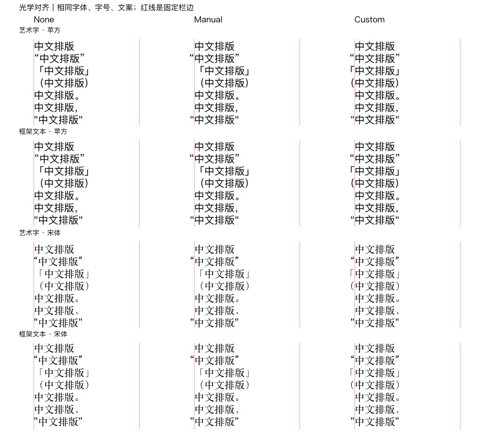
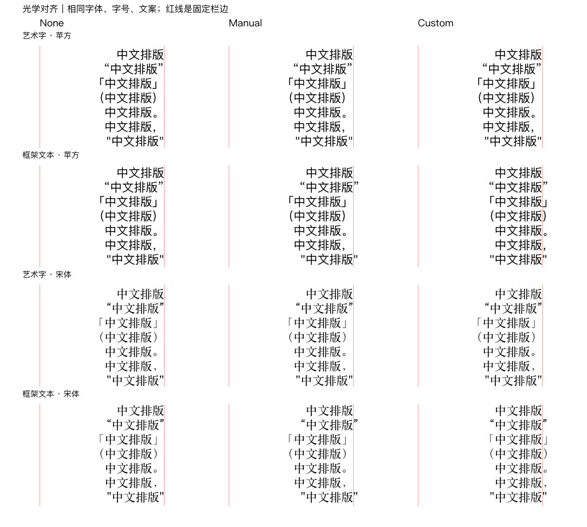
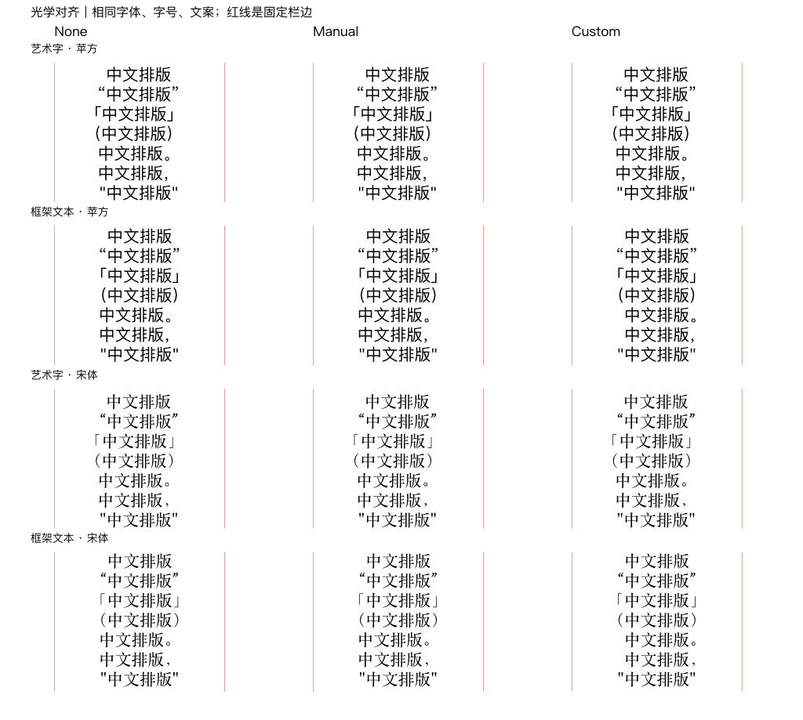

# 3.3.1.4940 MacOS 光学对齐与中文标点证据

观察日期：2026-10-20。本页记录光学模式读写、界面自定义规则及中文主体偏移；不把段落排文、文字锚点和对象边界对齐当作同一操作。

<a id="d-01"></a>
## D-01：身份、样本与测量

应用自报 `Affinity 3.3.1.4940 MacOS (Oct  6 2026)`。SDK 独立版本、代理实际加载身份及宿主精确版本未单独记录；不能继承[早期批量样本](2026-10-19.md#b-01)的插件身份，也不能用仓库候选版本代填。

两批分别使用自建未保存的 1180 × 1060 document pixels、96 DPI、单 spread 文档。每批 84 个独立单行文字对象：Art/Frame × `PingFangSC-Regular`/`STSongti-SC-Regular` × 三组模式 × 七种字符串。字体高度 24 document pixels；Frame 保持 250 × 29 的固定框。字符串为 `中文排版`、`“中文排版”`、`「中文排版」`、`（中文排版）`、`中文排版。`、`中文排版，`、`"中文排版"`。

首批比较 None/Manual/Font；第二批比较 None/Manual/Custom。**Custom 是经界面自定义规则的 Manual 样本标签，不是第四种 SDK 枚举。** 同批各阶段重复测量同一组对象，不是新增独立样本。全文、字体、高度和模式均读回；界面规则只作用于 28 个 Custom 对象，56 个 None/Manual 对照保持。

字形轮廓经 `node.curvesInterface.polyPolyCurves` 和 `node.baseToSpreadTransform` 测量，无需将可编辑文字转曲。本次简单字符串的轮廓项与码点逐项匹配后，单独合并四个汉字的边界；不推广为任意字体、连字或复杂脚本的一字一轮廓保证。下表的偏移均相对**同字体、同组、同对齐操作的无标点 `中文排版` 主体**：正数向右、负数向左，单位为 document pixels。零偏移不代表消除了字体侧承或与任意对象绝对视觉对齐。

<a id="d-02"></a>
## D-02：模式接口与自定义规则入口分开

| 入口 | 观察与结果 |
| --- | --- |
| `/glyphatts.js` 的 `GlyphAtts.opticalAlignmentType` | getter/setter 分别调用 `GlyphAttsApi.getOpticalAlignmentType` / `setOpticalAlignmentType`；独立属性对象上三模式设定与读回通过 |
| `/storydelta.js` 的 `StoryDelta.createOpticalAlignmentType(type)` | 调用 `StoryDeltaApi.createOpticalAlignmentTypeDelta(type)`；对 Art/Frame 的显式文本子选区格式化，实际模式读回与渲染通过 |
| `OpticalAlignmentType` | 枚举为 `None=0`、`Manual=1`、`Font=2`；开启 Manual 不等于新增字符规则 |
| 自定义字符集合、左右悬挂百分比 | **已查入口缺口**：已查安装应用的 JS wrappers、`story`/`dom`/`commands`/`application`/`common`/`fonts` 原生模块及相关原型、字符属性枚举，未找到对应规则表读写入口；官方 `latest` 和 `33001` 的完整符号索引各 10,440 项也只见模式相关光学入口。不是 MCP 协议限制或穷尽所有内部接口的证明 |

公开依据：[模式 getter](https://sdk.affinity.studio/33001/js/apis/GlyphAttsApi/getOpticalAlignmentType.html)、[setter](https://sdk.affinity.studio/33001/js/apis/GlyphAttsApi/setOpticalAlignmentType.html)、[delta](https://sdk.affinity.studio/33001/js/apis/StoryDeltaApi/createOpticalAlignmentTypeDelta.html)、[枚举](https://sdk.affinity.studio/33001/js/enums/OpticalAlignmentType.html)、[符号索引](https://sdk.affinity.studio/33001/js/objects.inv)。这些 API 声明与本页的实际样本结果分别提供证据；文档路径不作为独立 SDK 发布版本号。

已在样本中使用的模式应用路线如下；前提是已核对目标身份与授权，且是本页的未链接文本范围：

```js
const { Selection, TextSelection } = require('/selections.js');
const { DocumentCommand } = require('/commands.js');
const { StoryDelta, OpticalAlignmentType } = require('/storydelta.js');
const selection = Selection.create(doc, textNode);
selection.addSubSelectionForNode(textNode,
  TextSelection.create(textNode.storyRange));
doc.executeCommand(DocumentCommand.createFormatText(selection,
  StoryDelta.createOpticalAlignmentType(OpticalAlignmentType.Manual)));
```

应用后读取 `textNode.story.getGlyphAttRunsFrom(0)` 中的 `glyphAtts.opticalAlignmentType`，并检查实际轮廓和渲染。一次 hints 查询曾声称没有光学对齐 API，与上述 wrapper 和实际模式写读不符；hints 未命中不能作为无接口的依据。该模式路线不能写入下节的自定义规则表。

<a id="d-03"></a>
## D-03：未自定义的 Manual 与 Font

这里的 Manual 指本次未编辑字符规则的对照，不承诺所有安装、模板或样式的默认规则相同。保持艺术字原文字锚点，以及固定框内设置段落 Left，是这一阶段的两种操作。

| 对象/操作与字符串 | 字体 | None | Manual | Font |
| --- | --- | ---: | ---: | ---: |
| Art 原锚点 / Frame Left，`“中文排版”` 的主体左边 | 苹方 | 12.888 | 0 | 12.888 |
| 同上 | 宋体 | 9.336 | 0 | 0 |
| Art 原锚点 / Frame Left，`「中文排版」` 的主体左边 | 苹方 / 宋体 | 24 / 24 | 24 / 24 | 8.4 / 24 |
| Art 原锚点 / Frame Left，`（中文排版）` 的主体左边 | 苹方 / 宋体 | 24 / 24 | 24 / 24 | 7.128 / 24 |
| Frame Right，`中文排版。` 的主体右边 | 苹方 / 宋体 | -24 / -24 | -24 / -24 | -9.12 / -24 |
| Frame Right，`中文排版，` 的主体右边 | 苹方 / 宋体 | -24 / -24 | -24 / -24 | -6.264 / -24 |
| Frame Centre，`中文排版。` 的主体中心 | 苹方 / 宋体 | -12 / -12 | -12 / -12 | -4.56 / -12 |
| Frame Centre，`中文排版，` 的主体中心 | 苹方 / 宋体 | -12 / -12 | -12 / -12 | -3.132 / -12 |

这组 Manual 改善引号，不会自动涵盖 `「」（）。，`；Font 的效果随字体及操作变化，不能概括为全部有效或全部无效。[产品光学对齐概念](https://affinity.help/publisher2/en-US.lproj/pages/Text/opticalAlignment.html)仅作 V2 背景，不替代本构建的 SDK 证据。

<a id="d-04"></a>
## D-04：界面规则生效不等于对象边界忽略标点

通过 Affinity 字符面板的光学对齐规则界面，将同一条左右均 **100%** 的 Manual 规则字符集合设为 `"'“”‘’「」（）。，`；移除测试中的重复零百分比规则。随后通过 MCP 格式命令切换段落对齐并测量，既有界面规则持续影响本样本排文。**自定义规则由 UI 设置，MCP 负责模式/段落操作和测量；没有实测 SDK 规则表写入。** 双侧 100% 用于受控验证，不作为所有中文排版的推荐百分比。

| 操作与代表字符串 | None / 未自定义 Manual | UI Custom | 适用范围 |
| --- | ---: | ---: | --- |
| Art 保持原文字锚点，`「中文排版」` / `（中文排版）` 主体左边 | 24 / 24 | 0 | 两字体；艺术字也能产生悬挂效果 |
| Frame Left，同上 | 24 / 24 | 0 | 两字体，框尺寸保持 |
| Frame Right，`「中文排版」`、`（中文排版）`、句末 `。` / `，` 主体右边 | -24 / -24 | 0 | 两字体 |
| Frame Centre，句末 `。` / `，` 主体中心 | -12 / -12 | 0 | 两字体 |
| Art 按对象左边重新定位，`「中文排版」` 主体左边 | 10.92 / 10.92 | 10.92 | 苹方；宋体约 11.954667，三组同样保持 |
| Art 按对象左边重新定位，`（中文排版）` 主体左边 | 9.648 / 9.648 | 9.648 | 苹方；宋体约 11.162667，三组同样保持 |
| Art 按对象右边重新定位，闭括号/句末 `。` / `，` 主体右边 | -24 / -24 | -24 | 两字体，三组同样保持 |

“按对象边界重新定位”是在每个对象当前 `getSpreadVisibleBox(false)` 上计算平移，使左边、右边或中心落在相应参照位置；不是原生对象对齐命令的写入测试。它仍包含标点及相关排文空间，可能抵消文字锚点下的悬挂收益。此结果不说明艺术字不能悬挂，也不把固定框段落对齐与艺术字外接边界对齐当作同一个算法。

下图列为 None、未自定义 Manual、UI Custom；每组首行为无标点基线，四个区块依次为艺术字/框架文本的苹方、艺术字/框架文本的宋体。红线标示固定栏边，中心对照的轴为两条栏边的中点；图片用于可视对照，数值以 SDK 测量为准。







两批指定临时文档最终关闭且未保存，重新枚举为空；未修改既有文稿。未验证其他构建/平台、字体、字号、多行自动换行、链接文本、混排、效果/裁切、改字后的规则持续性、规则模板复制或保存/打印。随包旧版文本定位配方将全部字形作为内容边界；本页的“中文主体”另行排除标点，不能直接把全部字形边界套成主体光学对齐公式。仓库 docs 增补不表示随包指引或已安装插件已刷新。
