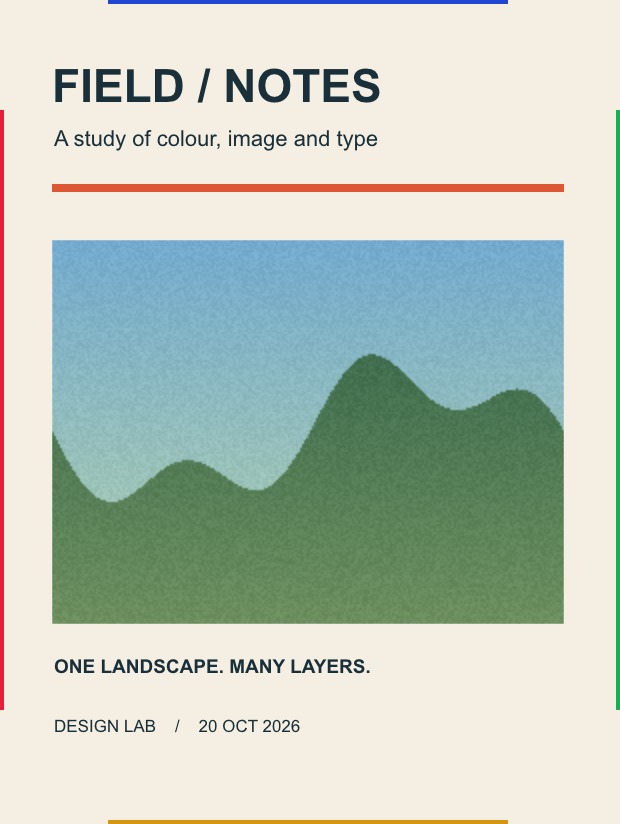
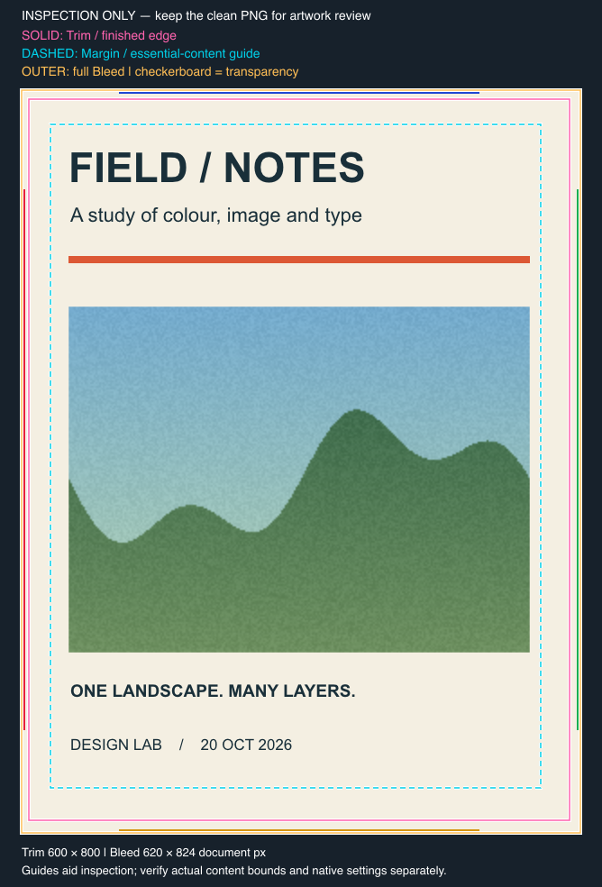
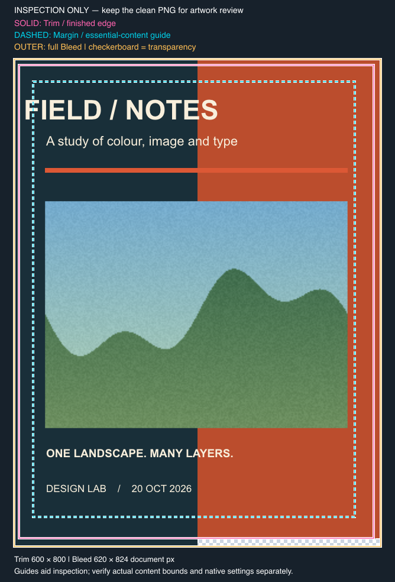

# 海报预览与原生页面设置：脱敏证据

观察日期：2026-10-20。应用自报 `Affinity 3.3.1.4940 MacOS (Oct  6 2026)`，独立 SDK 版本未取得。实验使用在 Codex/functions 中注册的 Affinity MCP 工具。已安装插件清单为 `0.4.3`，其原始代理文件保持不变；宿主精确版本，以及本轮宿主进程与安装目录之间的独立绑定，都没有记录。仓库里的开发候选版本不能用来代填这些运行身份。

本页只记录未保存、可以丢弃的合成海报。两个 12 对样本组分别统计；探索性试验、先前的矩形样本和旧的批量插入数据都没有混入。

## C-01：可编辑内容与实际页面设置

- 单画板，裁切尺寸 600 × 800 document pixels，96 DPI；补充的只读样本里，`Document.units` 等于 `UnitType.Pixel`。原生 Margin 为 L/T/R/B = 24/28/32/36 px，`useMargins=true`、`hasMargins=true`；实际的 `ArtboardInterface.marginBox` 在 spread 坐标中为 `(24,28)`、544 × 736 px。
- 创建选项中设置了 Bleed L/T/R/B = 8/10/12/14 px。文档设置界面显示了四边的值和启用状态；这是执行者的视觉观察，没有保存可以重看的界面截图。SDK 的实际 trim extents 为 `(0,0)`、600 × 800，includeBleed extents 为 `(-8,-10)`、620 × 824 px。查过的 wrapper/native 表面没有找到从活动文档取得 `DocumentProperties.bleed` 对象的读取路径；选项对象或几何查询都不能称为原生 Bleed 属性 getter。
- 内容包括四个可编辑的 Artistic Text（分属四个独立语义块）、一个 256 × 192 的 RGBA 嵌入位图和六个矢量对象，共十一个内容节点加一个画板。位图是确定性生成的有纹理风景，不是外部照片，放在 `(44,230)`、512 × 384 px 的位置；完整源像素校验和节点 raster 读回一致，不依赖外部图片文件。
- 全文、字体/字号 runs、六矩阵分量、可见性、选区和几何的读回都匹配；四个文本对象的非空可见边界都在实际 Margin 安全框内。背景延伸到 Bleed 外缘，四边各有不同颜色的受控标记。本样本没有覆盖链接文本、混排、复杂遮罩、多画板或 Layout 母版继承。

## C-02：默认预览只覆盖裁切区

`render_spread` JPEG、全内容选区的 `render_selection` JPEG 和默认 PNG/`FileExportArea.createForCurrentSpread()` 都没有显示四边外侧的标记；默认 spread JPEG 与 PNG 的实际尺寸是 600 × 800。原生 Bleed 已经配置，不等于预览会包含 Bleed。

实验用十二对独立文档比较两种做法：一种用一个脚本创建/配置/填充，随后调用 `render_spread`；另一种在同一脚本里创建/配置/填充并导出 PNG 回传。两种格式分别解码，检查全部 480,000 像素，结果都与排除在统计外的各自基准图一致；本页不声称 JPEG 与 PNG 无损等价。

总耗时中位数从 5080.5 ms 降到 2946.5 ms，中位数比值的降幅为 42.00%，十二对全部较快；按先后顺序分层做整对 bootstrap，95% 区间为 37.10%–49.83%。两个顺序层各六对，降幅分别为 45.32% 和 37.98%。这个结果只通过了裁切区预览，完整 Bleed 的验收失败，不能用性能收益掩盖范围上的缺口。

## C-03：完整选区导出与选区区域不同

同一个已经核对过的十一内容节点选区包含背景，选区外缘恰好等于实际的 620 × 824 Bleed 范围。`FileExportArea.createForSelection(selection)` 的 PNG 覆盖了全部范围，四边标记完整；`createForSelectionArea(selection)` 没有保留同样的外侧内容，两者不能互换。选区的普通内容包围盒也不能自动充当 Bleed 框。

完整选区与 CurrentSpread 的 PNG 在裁切区内有少量栅格化差异，没有通过跨范围逐像素相等的探索性检查。因此下一组只比较同一个完整选区 PNG 路径，不把不同范围的输出说成像素等价。检查到的 `FileExportOptions` wrapper/native 表面没有 `includeBleed` setter；这个选区方法既不是设置该属性的入口，也不是通用的 Bleed 开关。

图像保留合成样本的完整 RGB 像素，并移除了原始导出元数据；这张图可以重看，但不替代对文档原生设置的读回。

## C-04：同范围 PNG 的单调用总耗时

另十二对独立文档比较下面两种做法：

- 基线：先用一个 `execute_script` 创建空白文档、配置原生设置并创建全部内容，再用第二个 `execute_script` 核对身份/状态、导出完整选区 PNG、读回 Base64 并删除临时文件。
- 候选：用一个 `execute_script` 完成相同的创建/配置/内容，以及完整选区 PNG 的导出、读回和清理。输出格式、范围与分辨率都相同。

两组使用固定、平衡的先后顺序，每层六对。基线的第二个脚本模板在计时前生成；创建之后只在内存里替换已确认的新文档 UUID，没有把脚本生成工具的调用计入基线。两边都从发出创建空白文档请求之前开始计时，到完整原生图像发出并完成显式 handoff 为止；计时使用 `Date.now()`。状态检查、解析和图像 handoff 计入，后续的像素验收、诊断持久化、撤销和关闭不计入。终点不是前端完成绘制，也不是 Agent 完成视觉判断的确认。

| 范围 | 对数 | 基线中位 ms | 单调用中位 ms | 中位数比值降幅 | 较快/较慢 |
| --- | ---: | ---: | ---: | ---: | ---: |
| 全部 | 12 | 4714.5 | 2638 | 44.04% | 12/0 |
| 基线先执行 | 6 | 4558 | 2646.5 | 41.94% | 6/0 |
| 候选先执行 | 6 | 4735 | 2494 | 47.33% | 6/0 |

整对在顺序层内重采样 20,000 次，固定种子 20,000，百分位区间使用线性插值：全部中位数比值降幅的 95% 区间为 36.47%–52.03%；两个顺序层分别为 31.55%–55.35%、20.95%–58.64%。前六对与后六对的降幅分别为 38.46%、48.16%；所有慢样本都保留，最小配对差值仍有 218 ms。固定顺序和每层六对的规模限制了结论的推广，不能视为跨日期、客户端或任意海报的稳定收益保证。

二十四张 PNG 都解码为 620 × 824，全部 510,880 个 RGB 像素与独立于计时的基准一致；四边标记另行逐像素检查。RGB SHA-256 为 `99d19293b7082b7c9ca05da9bc8df9300651f64156e1a4615e899032c0c44e0d`。每一侧还比较了全部内容状态、选区、原生 Margin 和 Bleed 几何；导出后这些状态不变，临时 PNG 删除检查通过。完整文字/位图/四边 Bleed 的图像完整性和这个受限的总耗时收益都有样本依据。

两组里的每一侧各做一次 content-batch undo，都回到保持原配置的空画板和画板选区，随后只关闭自己的样本，文档清单回到空。一个脚本包含创建、配置和导出，不等于这些动作整体只有一个撤销步骤。最终只读审计另行核对了文档清单和所有试验临时路径。

## C-05：由完整图像派生独立检查预览

在 C-03 的公开合成 PNG 上，按同一样本的 spread document-pixel 几何生成独立 SVG，再在本地渲染成 PNG。这一步不调用 SDK，也不更改工程，不能视为新的原生导出能力。几何和精确的 PNG 文件 hash 保存在[公开夹具](../../../assets/sdk-evidence/poster-inspection-geometry.json)，运行工具是随包的[检查图生成器](../../../skills/affinity-mcp/scripts/inspection-preview.mjs)。

原图保持 620 × 824 的原尺寸，检查图加上图例留白后为 668 × 984；图像原点偏移为 `(24,100)`。Trim 在图上为 `(32,110)`、600 × 800，启用的 Margin 框为 `(56,138)`、544 × 736。橙色外框表示完整 Bleed，品红实线表示 Trim，青色虚线表示 Margin。SVG 里嵌入的 PNG 字节与源文件相同；去掉标线组重新渲染后，图像区域全部 510,880 个 RGB 像素与原图一致。带标线图与原图的差异都局限在框线附近，所以还需要保留无标记的原图来检查边缘细节。

图例和框线用来判断重要内容的安全距离以及背景覆盖情况，不把背景越过 Margin 判作错误。未知设置、跨页面或旋转坐标、错误选区和缺失出血不能靠画框修复；仍要按[检查流程](../../../skills/affinity-mcp/references/inspection-preview.md)验证来源和实际内容边界。这张派生图不计入 C-04 的计时，也没有新增关于任意工程、印前色彩或自主 Agent 判断正确率的证据。

## C-06：文字越界与透明出血缺口的负例

同构建的一个新一次性样本沿用 600 × 800 trim、96 DPI 和启用的原生 Margin（有效框 `(24,28)`、544 × 736）。创建选项的 Bleed 为 L/T/R/B = 8/10/12/14，实际几何读回为 `(-8,-10)`、620 × 824；没有新增活动文档 Bleed 属性 getter 的证据。内容为四个可编辑文字块、一个嵌入位图、一条装饰线和两块实际背景，共八个内容节点加一个画板。

- 负例标题可见边界的左侧实际为 `11.3916015625`，越过 Margin 左边约 `12.61 px`，仍在 Trim 内；匹配对照为 `47.3916015625`。
- 左背景覆盖完整高度，右背景在原生坐标 `y=800` 处截止；Bleed 底边为 `814`，所以底部右半存在 310 × 14 px 的缺口。源 PNG 中这个区域的 4,340 个像素都是透明的。两块实际背景的联合范围仍然覆盖完整导出包围盒，没有加覆盖对象、边缘标记或补白来假造完整出血。
- 完整 PNG 都解码为 620 × 824；十二个正式负例的全文/样式/位图、坐标、选择和 Margin 状态都匹配，全部 RGBA 像素与排除在计时外的负例一致。透明源图的嵌入字节不变；棋盘只位于检查图的源图下层，不能把合成后的 RGB 与带透明的原图直接等同。

两组各有两名处于隔离上下文的读者，只看匿名检查图，顺序相反，回答冻结后才对照真值：实心深色底图的两位读者都发现了标题越界，但都没有报告出血缺口；添加棋盘底和透明图例后，两位全新的读者都指出了这两项问题，而匹配对照没有被报告这两项问题。这是围绕指定图例和缺陷的少量盲读样本，不是普遍检出率，也不证明其他背景或细小缺陷一定可见。

[同版式无这两项缺陷的对照图](../../../assets/sdk-evidence/poster-inspection-control.png)、[无标记 RGBA 源图](../../../assets/sdk-evidence/poster-inspection-negative-clean.png)、[公开几何夹具](../../../assets/sdk-evidence/poster-inspection-negative-geometry.json)。源图和检查图只含合成内容，已经移除原始导出元数据。

另一组预先设了六对独立负例文档，两个执行顺序各三对，比较相同的单次 SDK 创建/配置/内容/完整 PNG 路径：直接交付原图，以及交付原图加标线图。计时从请求创建空白文档前开始，到完整图像发出并显式 handoff 结束；包含导入、身份/全量状态检查、PNG 导出读取、Desktop 临时文件删除、两边相同的完整回包本地文件传递、宿主工具等待、解码/几何核对和源图落盘。带线一侧还要额外生成 SVG、渲染 PNG 并交付两张图。SDK 和本地处理环境已经预热；最终诊断持久化、像素验收、撤销/关闭和读图推理都在终点之后，不是前端 paint，也不是 Agent 完成判断的耗时。文件传递路径用来避开宿主后处理脚本的大小限制，不与 C-04 的直接图像路径合并比较。

| 范围 | 对数 | 原图总耗时中位 ms | 原图＋标线图总耗时中位 ms |
| --- | ---: | ---: | ---: |
| 全部 | 6 | 4279.5 | 3611.5 |
| 原图先执行 | 3 | 4862 | 3589 |
| 带线先执行 | 3 | 3697 | 3634 |

带线总耗时的范围是 3113–4125 ms，原图为 3096–5849 ms；六对中带线有五对较短、一对较长。带线一侧本地生成 SVG 加渲染 PNG 的中位耗时约 64.25 ms，全部本地处理约 82.72 ms；这些是总耗时里的子项，不等于端到端额外成本。两侧 SDK 脚本内部的中位耗时为 526.5/525.5 ms，而包含 SDK 执行的工具往返中位为 3698.5/3074.5 ms。等待和顺序差异很明显，不能把总体中位差解释成加标线本身提速，也不能据此承诺稳定延迟。

十二个正式样本和两个排除在计时外的样本都按已确认身份恢复到空画板后再关闭，十四个可能的 Desktop 输出路径都不存在；最终打开的文档清单和当前文档都恢复成初始已有的文档。没有关闭无关工程。这个样本不新增原生 Bleed getter、任意多页/旋转/继承、印前色彩、不同宿主或自主 Agent 整体耗时的证据。

## 使用边界

完整选区必须恰好覆盖所需的 Bleed；偏移、隐藏或不完整的选区、任意离画板对象、嵌套裁切或其他页面结构都需要重新验证。宿主必须收到完整 Base64 并显式显示图像，文件访问需要已有授权。本次近 195 KB 的 PNG 和超过 260,000 字符的回包完整通过，不据此推断通用的输出上限。

没有验证真实印刷尺寸、PDF 页面盒、印刷色彩/ICC 正确性、复杂透明效果、外部照片资源管理、长期内存、异常导出恢复，也没有验证自主 Agent 使用新 Skill 的决策耗时；代理传输内部各个等待阶段也没有被这个配对拆分。它证明的是当前样本的完整预览路径，不是印前合规，也不是代理内部根因已经解决。
