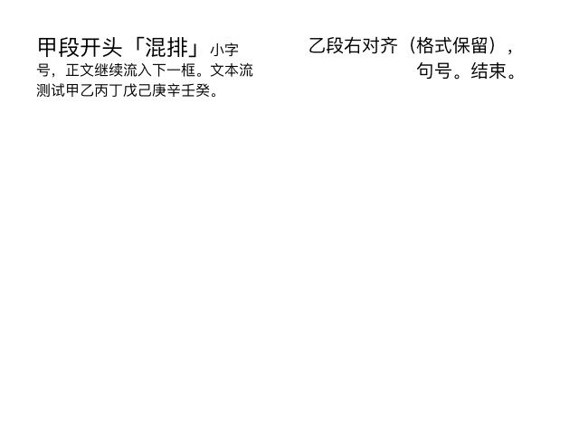
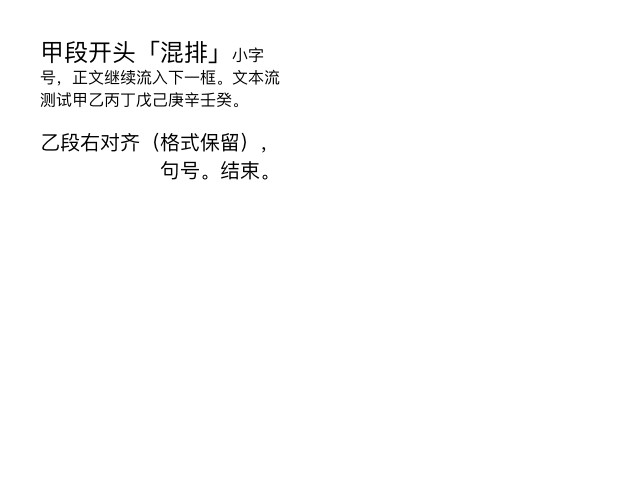
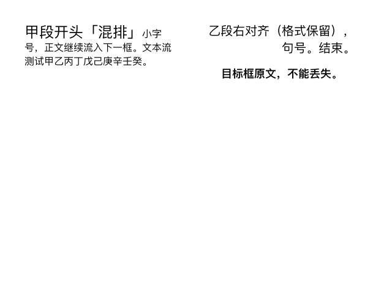

# 3.3.1.4940 MacOS 文本框链接与异步关闭证据

观察日期：2026-10-21。本页记录两组双框文本流、取消链接、格式及撤销恢复，以及未保存样本的异步关闭；不继承其他构建或任意业务文稿的结果。

<a id="e-01"></a>
## E-01：身份、样本与比较字段

应用自报 `Affinity 3.3.1.4940 MacOS (Oct  6 2026)`，`app.buildVersion=1`；独立 SDK 版本未取得，括号日期不解释为发布日期。实验使用已核对的插件 `0.5.3`，宿主精确版本未记录；后续开发候选不能代填本次运行身份。

两组各使用一个自建未保存的 640 × 480 document pixels、96 DPI、单 spread 文档，各含两个 `FrameTextNode`。源框为 `(40,40,240,86)`，目标框为 `(340,40,240,360)`，元组依次为 x、y、width、height。第一组目标框为空；第二组目标框已有独立文字及格式。每次写入均校验本次样本文档身份并重新获取节点。

源文本共 57 个 Story 字符，含一个段落分隔：

```text
甲段开头「混排」小字号，正文继续流入下一框。文本流测试甲乙丙丁戊己庚辛壬癸。
乙段右对齐（格式保留），句号。结束。
```

| 属性 | 源文本基线 | 第二组目标文本基线 |
| --- | --- | --- |
| 字符串与长度 | 上述全文，57 | `目标框原文，不能丢失。`，11 |
| 字体与字号 runs，半开区间 | `PingFangSC-Regular`；[0,8) 为 24px，[8,39) 为 16px，[39,57) 为 20px | `PingFangSC-Semibold`；[0,11) 为 18px |
| 段落对齐 runs | [0,39) Left=0，[39,57) Right=2 | [0,11) Centre=1 |
| 段落其他比较值 | 左右缩进、段前均为 0，段后 16px | 同左 |

快照比较全文、Story 长度、glyph/paragraph runs 及表中属性、节点标记、`storyRange`、`textBegin`、流顺序/首尾标记/成员、baseBox、spread 可见边界、六分量变换及 text render/UI scale。它不证明所有字符或段落属性均已验证。实验读取当前 wrappers 与参数范围；命令声明只作入口依据，以下后态与渲染才是操作证据。

<a id="e-02"></a>
## E-02：链接到空框与取消链接

在已授权、已校验身份的临时文档中执行：

```js
const { DocumentCommand } = require('/commands.js');
// doc、source、destination 已绑定到同一指定样本及当前 spread。
doc.executeCommand(DocumentCommand.createLinkTextFrame(source, destination));
// 读回并留存链接状态后，再单独测试：
doc.executeCommand(DocumentCommand.createUnlinkTextFrame(destination));
```

链接后，两框读取同一完整 Story，全文仍为 57 字符，三组字号及两组段落格式保持。源框 `storyRange=[0,39)`，目标框 `[39,58)`，后者含 Story 终止符；`textBegin` 分别为 0、39，flow index 分别为 0、1，两框的流成员均为源框、目标框。渲染确认第一段在源框、第二段接排到目标框，框几何、变换及文字缩放保持。

**对目标框执行取消链接后，目标框变为空 Story，全部 57 字符及原格式回到源框的 Story，源框重新溢出。** 这不是按当前可见文字把两框拆成各自独立的内容；目标框变空也不表示该部分文字被删除。两框均恢复为单框流，框几何及缩放未变。指定用例样本通过。





<a id="e-03"></a>
## E-03：链接到已有文字与格式的目标框

同一路线将源框链接到包含 11 字符原文的目标框。合并后的 Story 为“源全文 + 一个段落分隔 + 目标原文”，长度 69；目标原文位于 [58,69)。源框排文范围仍为 [0,39)，目标框为 [39,70)，含终止符。

原有字符的字体、字号及上述段落属性按合并后的偏移逐字符比对一致：源段末新增的分隔符使用 20px/Right，目标原文保持 18px 半粗体/Centre；目标原文没有被覆盖。对目标框取消链接后，**源框保留合并后的全部 69 字符及这些格式，目标框为空**，不会恢复链接前两框各自的原文。只有本样本的撤销链接操作恢复了原先的 57/11 分配。框几何、变换及文字缩放均保持。指定用例样本通过。



<a id="e-04"></a>
## E-04：撤销与重做恢复

两组均实际执行单步 undo 撤销链接、redo 重做链接，以及取消链接后的 undo、redo、再次 undo。分别与留存的未链接、已链接、取消链接快照比较 E-01 所列字段；源/目标文字分配、格式、文本流关系和几何恢复一致。两组最后再次撤销取消链接，取得的完整渲染 PNG 分别与各自首次链接状态的 PNG 字节完全一致。

这只证明这两组命令和历史的单步恢复；不从 API 调用数推导任意历史的撤销次数，也不把取消链接当作撤销链接的替代操作。关闭文档后的撤销、重新打开或恢复未保存内容没有验证。

<a id="e-05"></a>
## E-05：异步关闭会直接丢弃未保存内容

第一组通过 `doc.closeAsync(callback)` 关闭，第二组通过 `doc.promises.close()` 关闭。两次关闭前均读到 `isDirty=true`、`needsSaving=true`，没有调用 save/saveAs，也没有执行保存提示交互。

| 入口 | 完成结果 | 后置状态 |
| --- | --- | --- |
| `Document.closeAsync(callback)` | 回调触发，只有一个参数，错误参数为 `undefined` | 在回调内重新枚举，目标已消失，文档列表为空 |
| `document.promises.close()` | 等待 Promise 成功完成，值为 `undefined` | 完成后重新枚举，目标已消失，文档列表为空 |

本次 `execute_script` 顶层 await 解析失败；返回异步函数调用的 Promise 可等待完成，实际 Promise 关闭路线为：

```js
// doc 已按确认的文档身份绑定，且已获丢弃该样本内容的授权。
return (async () => {
  await doc.promises.close();
  // 重新枚举文档，确认该目标消失及其他文档保持。
})();
```

**这两个异步入口在本构建的指定未保存样本上直接关闭并丢弃未保存内容，没有保存或提示保护。** 不得依赖 GUI 的保存提示替 SDK 兜底，也不得将一般关闭请求解释为丢弃用户工作。实际操作前核对身份、保存状态及保存/丢弃意图；已有明确丢弃授权可复用，需保存时先按授权保存并验证结果。关闭成功以回调/Promise 完成及目标从清单消失共同判断；超时或结果不明先查清单，不重放关闭。

公开入口依据：[链接命令](https://sdk.affinity.studio/33001/js/apis/DocumentCommandApi/createLinkTextFrameCommand.html)、[取消链接命令](https://sdk.affinity.studio/33001/js/apis/DocumentCommandApi/createUnlinkTextFrameCommand.html)、[异步关闭](https://sdk.affinity.studio/33001/js/apis/DocumentApi/closeAsync.html)。Promise wrapper 转调 closeAsync；声明本身不能证明以上丢弃语义。

## 清理与未覆盖范围

实验开始时没有打开的文档；两个指定临时样本均已关闭且未保存，最终重新枚举为空、当前文档为空。没有修改或关闭现有文稿。原始脚本及运行标识不进入本页，以上三张图片仅含合成文字，属于开发证据，不进入安装包。

未测三框或更长链、跨 spread/文档、从源框或链中间框取消链接、艺术字链接、任意混排属性、对链接范围新增格式、保存后重开、已有磁盘文件的未保存修改、异步关闭的取消/失败/超时及应用恢复；未测其他构建/平台。链接保持既有段落格式不证明链接后任意范围格式写入正确，也不扩展此前光学规则的链接流结果。
