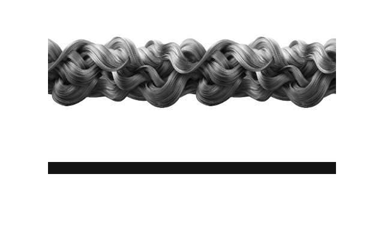
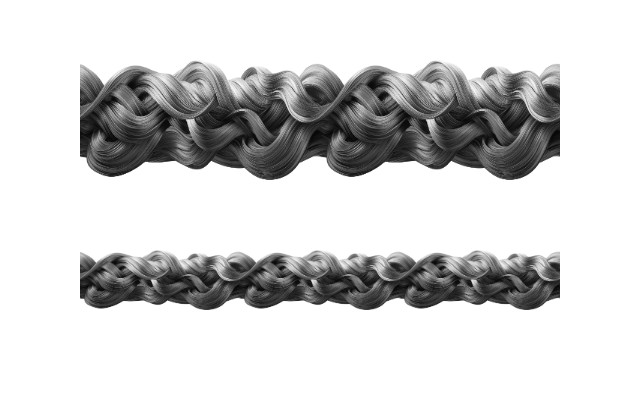

# 已有路径画笔的读取、克隆与复用

本摘要记录 2026-10-22 在 `Affinity 3.3.1.4940 MacOS (Oct  6 2026)`、`app.buildVersion=1` 上的限定样本。平台是证据环境，不是使用白名单。本次没有独立核验运行代理或宿主的精确版本，不以仓库候选版本代填。未改写 [2026-10-21 的工厂失败记录](2026-10-21-sdk-availability.md#f-05)。

## G-01：范围与前提

新建一个 640 × 420px、96 DPI、单 spread、未保存的合成文档，创建两条水平 PolyCurve：源线从 (80,120) 到 (560,120)，目标线从 (80,280) 到 (560,280)。初始均为 20px 实线，`pathBrush=null`。

在 Vector Studio 的 Path Brushes 面板中，由界面为源线应用一个预装的编织纹理图像路径画笔。随后所有读取、克隆、修改和目标线应用均通过 MCP 执行 SDK。此界面准备步骤不是 SDK 创建或枚举预设的证据。[官方应用方法](https://www.affinity.studio/help/curves-shapes-path-brush-line-style)、[面板入口](https://www.affinity.studio/help/panels-path-brushes-panel)。

开始时没有打开其他文档；每次写入绑定本次样本文档。完成后只关闭该样本，重新枚举文档为空，没有保存原生文件或改动既有文稿。截图是合成样本的 MCP JPEG 渲染，视觉观察与 SDK 数值分别记录，不作像素级一致性认证。

## G-02：已验证的获取与克隆

| 操作 | 后置结果 |
| --- | --- |
| 读取源线的 `node.lineStyleInterface.lineStyle.pathBrush` | 取得真实 PathBrush；线型 Texture(3)、线宽 120、brushWidth=120、sizeVariance=0.5、opacityVariance=0、tailOffset=1、headOffset=0、isRepeat=true、sizeControllerType=1、cornerStrategy=0 |
| `PathBrush.clone()` 后将克隆的 `brushWidth` 改为 60 | 克隆读回 60，原实例与重新读取的源线仍为 120；克隆独立性通过 |
| `LineStyle.clone()` 后设置克隆画笔与 weight=60 | 脱离文档的线型、宽度和画笔字段读回匹配；实际应用另见 G-03 |

## G-03：应用、渲染与历史恢复

对目标线依次调用 `Document.setLineStyle`，分别指定 `LineStyleMask.Weight`、`LineStyleMask.Brush`、`LineStyleMask.Type`；每次同时指定 `contentType=ContentType.Main`、`useTextSelection=false`、`defaultsMode=LineCommandDefaultsMode.None`。枚举来源分别为 `/linestyle.js`、`affinity:dom` 和 `affinity:commands`，参数依据当前 wrapper 与[原生签名](https://sdk.affinity.studio/33001/js/apis/DocumentCommandApi/createSetLineStyleCommand.html)。

目标读回 Texture(3)、weight=60、brushWidth=60，其余已比较画笔字段与源线一致。两条曲线的 480px 中心线范围、位置和六项 domain transform 保持；源线仍为 120px，已比较字段未变。JPEG 中源线显示较粗的编织纹理，目标线显示较细、重复次数更多的同类纹理。

三个有效命令在该样本中分别形成历史位置 16、17、18，基线为 15。实际逐步执行三次 undo、三次 redo，再重复一轮：两次 undo 终态都与基线相同，目标恢复 20px 实线且画笔为空；两次 redo 终态都与应用后快照相同。比较覆盖两条曲线的数量与名称、线型、线宽、上述画笔字段、中心线范围和六项变换。这里只证明这组三命令的历史，不把三次调用推广为其他场景的固定撤销次数。

## G-04：失败与入口缺口

| 路线 | 本次结果与边界 |
| --- | --- |
| `PathBrush.createDefault()` / `RasterBrush.createDefault()` | 再次抛出 wrapper 的 `not yet implemented in C++ API` 占位错误；没有进入成功的原生创建 |
| PathBrush/RasterBrush 从零创建、加载或枚举预设 | 当前两个 wrapper、`affinity:brushes` API 原型链及官方 `/33001/js/objects.inv` 的画笔相关符号中未找到相应入口；这是已查范围，不宣称穷尽全部 SDK |
| RasterBrush 实例 | 未取得有效实例，不能执行实例克隆、修改或绘制验收；保留为获取入口缺口，不把 PathBrush 的成功外推给它 |
| `LineStyle.create` 工厂 | 显式 `resIndependent=false`、`balancedDashes=true` 的 Solid 控制成功；相同条件下 Texture 无画笔及传入已有画笔的两个用例均返回 `INVALID_ARGS`。原因未确定，不把该工厂列为有效 Texture 创建配方 |
| `setLineStyle` + `LineStyleMask.All` | 在该样本中未报错，但目标仍为 20px 实线、画笔为空；补齐上述显式 options 后仍无效。单字段掩码路线通过，不宣称 All 在全部场景失效 |

只确认已有真实 PathBrush 的指定字段读取、克隆独立性、宽度修改、复用、视觉效果及这组历史恢复。其他预设、RasterBrush、从零创建、外部文件加载、保存重开、任意路径几何和画笔参数仍需各自证据；没有写入共享 hint 或提交 SDK 报告。
