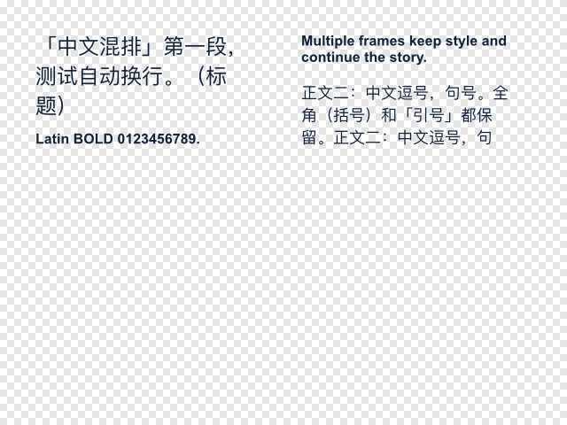
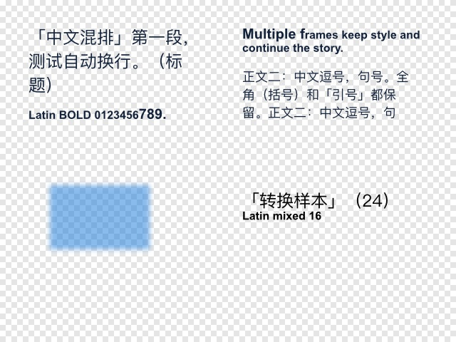
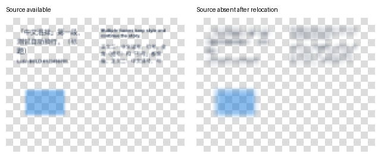

# 导出、保存、文本链与混排补测

观察于 2026-10-22；应用自报 `Affinity 3.3.1.4940 MacOS (Oct  6 2026)`。这是应用内 SDK、界面操作及独立文件解码的有限样本；运行代理的精确身份、宿主版本和本次独立 SDK 版本未单独核验，不用仓库候选版本代填。平台仅标记证据环境，配方不设系统白名单。

## H-01：样本与验收范围

开始时文档清单为空。主样本为两页、两个独立 spread，各 640 × 480 document pixels、96 DPI、透明背景。三框 A→B→C 横跨两页：A=(40,40,250,140)，B=(340,40,250,140)，C=(40,40,550,330)。链接前全文在 A，B/C 均为空。178 字符 Story 含中文标点、段落分隔、PingFangSC-Regular 的 24/18px 与 Arial-BoldMT 的 16px runs。另加入一个半透明蓝色矩形和 8px Gaussian Blur，及独立的双行艺术字转换样本。

所有编辑、保存、覆盖和重开只针对自建样本及专用临时目录；没有读取或修改已有工作文稿。比较字段为全文/长度、字符 run 范围与字体/字号/scale/光学模式、段落 run 范围与水平对齐、框几何、六分量节点矩阵、flow 顺序/front/back/textBegin 和 render/UI 矩阵；不代表比较了任意字体或段落属性。

## H-02：三框、跨 spread 链与局部格式

`createLinkTextFrame(A,B)` 后再 `createLinkTextFrame(B,C)` 成功。共享全文、原有 runs、框及矩阵保持；三个 `textBegin` 为 0、45、134，成员顺序为 A/B/C。跨 spread 链接在 A/B 所在 spread 为当前 spread 时执行；这不推广到任意命令无需切换 spread。撤销第二次链接恢复 A/B 链和独立空 C，重做恢复三框状态。

对 A 的 Story 范围 [40,55) 写入 Height=20，跨越原 A/B 排文边界，产生 [22,40)=16、[40,55)=20、[55,97)=16 的 Arial runs；全文、其他已比较样式及几何保持。undo、redo、再次 undo 均匹配快照。范围使用 Story 坐标，不是框内从零计数。

独立导出的两页 PDF 还核对了 C 的接排末文，见 H-06；单张第一页图不证明第三框可见内容。

## H-03：中间框与链首框取消链接

| 动作 | 实际后态 | 历史恢复 |
| --- | --- | --- |
| `createUnlinkTextFrame(B)` | A 独立并保留全部 178 字符及已比较 runs；B/C 仍互相链接，但 Story 为空。B/C 的 textBegin=0/1，后者包含终止符语义，不能解释成仍有可见文字 | 单步 undo/redo/undo 分别匹配前后快照 |
| `createUnlinkTextFrame(A)` | 三框 flow 成员仍为 A/B/C，但三个框共享的 Story 长度全部变为 0，文字及 runs 被清空；未实现“保留内容地移除链首” | 单步 undo 恢复全文与格式，redo 再次清空，再 undo 恢复 |

**链首操作未达到保留内容的目标，属于数据丢失反例。** 不能把“在此框前断链”应用到链首；正常操作先拒绝链首目标，另行设计、授权并验证移除/拆分方案。不把历史可恢复推广到保存、关闭或历史被裁剪之后。

## H-04：混排替换与框架增高

对三框 Story 全文执行 `createSetText`，即使写回同一个字符串，原 24/16/18px 三个 runs 也合为全文 24px/PingFangSC-Regular。对 [18,28) 等长替换为十个拉丁字符，跨过 [0,22) 与 [22,97) 样式边界：新插入范围全部继承 24px，第二个样式从 22 推迟到 28。两项均可撤销恢复，但均**不是保混排替换通过**。

该局部范围还覆盖一处分段符；替换串不含换行，段落随之合并是本次输入的预期结果，不能计作异常。这个反例不冒充同一段内任意跨字体替换的穷尽测试。

另在已保存重开的 24/16/20/16/18px 样本中，将 A 保持 (x,y,width)=(40,40,250)，height 从 140 改到 180：

- 界面拖动普通底边中点手柄，全文、glyph/paragraph runs 和 textUiScale 保持，B/C 的 textBegin 从 45/134 变为 97/160。
- SDK 使用 `DocumentCommand.createTransform(selection, transform, options)`，transform 的 Y 比例为 9/7、Y 平移为 -80/7，锚定原左上角。显式 `mergeable=false, cloneRaster=false, duplicateNodes=false`，分别测试 `correctChildren=false/true`；两者都得到相同限定排文结果，并可撤销恢复，不支持 hint 中“true 必不可少”的断言。
- 节点 Y scale=9/7，textRenderScale 的 Y scale=7/9，二者补偿后文字没有被拉高；textUiScale 保持单位矩阵。不能要求每个原始矩阵都不变，也不能只读字号就宣称有效大小保持。

这是已知目标高度的单轴增高样本，不是自动测高/fit-to-content，也不验证旋转、剪切、任意非均匀变换或文字溢出检测。

## H-05：界面艺术字转框架文本

对独立双行艺术字执行界面“图层 → 转换 → 转换为文本框”。转换前后均为 25 字符，PingFangSC-Regular/24px 的 [0,11) 与 Arial-BoldMT/16px 的 [11,25) runs、段落对齐与已比较缩放保持；类型从 ArtTextNode 变为 FrameTextNode。undo/redo 匹配快照，转换后两行可见。

边界从约 (341.227,270.152,202.701,38.442) 改为 (340,269.36,220.8,39.038)，**不构成几何或视觉位置完全无损**。已查公共 commands wrapper 及官方 DocumentCommandApi 列表只有 ConvertToCurves 等入口，没有找到同名文本框转换命令；本例是界面转换后由 MCP 核验，不能记成 SDK 原位转换。用 StoryBuilder 重建新对象也不等于已验证原位转换。

## H-06：文本、透明度、效果与多页导出

实际枚举预设后使用本机对应的 PNG、JPEG（最佳质量）、WebP（无损，默认值）、SVG（用于导出）、PDF（用于导出）；预设名不作为所有安装的常量。全部已完成导出记录的 result=OK、无 warning/error；另按真实文件验收：

| 路线 | 独立后置检查 |
| --- | --- |
| PNG / CurrentSpread；异步 PNG / CurrentPage；无损 WebP / CurrentSpread | 各 640×480 RGBA，三个文件解码后的全部 307,200 像素相同；角落 alpha=0，蓝色矩形内部 RGBA=(20,120,220,128)，模糊边缘存在 |
| JPEG / CurrentSpread | 640×480，不保留 alpha，透明背景合成白色，蓝色内部约 RGB=(137,187,236)；不与 RGBA 文件要求字节相等 |
| PNG / CurrentSpread，显式 `size={width:320,height:240}` | 实际 320×240；这是 Document.export 的 Size 参数，不是 ExportScale 工厂测试，不能修正两个历史工厂反例 |
| SVG / CurrentSpread | viewBox 为 0 0 640 480，9 个 text 元素引用两种字体；模糊图形成为一个内嵌 image。没有证明字体被嵌入，不能承诺无字体环境显示一致或效果仍完全矢量 |
| PDF / WholeDocument | 两页，各 480×360pt；独立渲染和文字提取覆盖接排内容，两页提取文本去除排文空白后等于原 Story；PingFangSC-Regular 与 Arial-BoldMT 子集字体有嵌入流 |
| PDF / `createForPages('2')` | 一页 480×360pt，提取内容与整篇 PDF 第二页相同，仅包含 C 的末文 |

PDF 嵌入、文字提取、视觉检查和栅格像素比较分别记录；不承诺 PDF 与 PNG 逐像素相同。这不是任意字体许可、彩色字体、照片、全部效果/预设或印前色彩验收。

## H-07：异步保存、覆盖与打包重开

`await d.promises.saveAs(ownedPath)` 新建原生文件，path 正确，isDirty/needsSaving 均为 false。随后对 [40,55) 改字号，两个标记均为 true；`await d.promises.save()` 覆盖同一自建文件后均为 false。关闭该样本并 `Document.load(ownedPath)`，重新绑定新身份，三框全文、五个 glyph runs、段落对齐、框/矩阵/flow 状态全部匹配保存前快照。

`await d.promises.saveAsPackage(ownedPackagePath, PackageResourcesPolicy.None)` 生成真实 afpackage 文件。该调用保持原文档 path；本例操作前已经因撤销历史变为 dirty，调用后两个标记仍为 true，不能把打包完成当作当前工程已保存。关闭样本后从包重开，已比较状态一致；包前后同范围 PNG 的解码像素完全相同。

本节 None 包内没有外部链接资源；不能用它证明 IncludeImages/IncludeTexts/字体收集或包可移植性。包含真实链接图片的独立后续样本见 H-09，离线原图保真目标未通过。

## H-08：出血与导出区域反例

另建 320×240px 文档，创建选项请求 L/T/R/B=10/12/14/16px Bleed，背景几何为 (-10,-12,344,268)。PNG / CurrentSpread 实际为 320×240；PNG / Selection 为 344×268。PDF（用于打印）/ WholeDocument 的 MediaBox、TrimBox、BleedBox 均为 240×180pt，仍是裁切尺寸。

这确认默认区域/预设没有输出请求的外围内容；创建选项和完整背景几何不替代活动文档 Bleed 属性及启用状态的独立读回。Selection 覆盖所选背景的内容范围，也不证明任意页面的原生 Bleed。完整印前出血目标仍未验收，不能靠“用于打印”的预设名或 OK 记录放行。

## H-09：含链接图片的包脱离原图后失真

独立后续样本在主工程的自建磁盘文件上继续。先仅设置 DocumentProperties.imageResourcePolicy=ImagePlacement.Linked，再通过界面置入本次导出的 320×240 PNG。MCP 确认 ImageNode、imagePlacement=Linked、原始尺寸 320×240、源文件大小 13,210 bytes、放置框 (343,330,150,112.5)；界面置入不算 SDK 加载图片入口通过。

`await d.promises.saveAsPackage(path, PackageResourcesPolicy.IncludeImages)` 生成真实包，随后关闭自建工程，把原图改名并将包复制到新子目录，重新通过 `Document.load` 打开包。全文、三框链、图像框/矩阵和资源元数据保持，但页面导出与包前有 **4,902 个 RGBA 像素不同**，全部位于图片区域，图像呈低清块状。

在原路径仍不存在时，`imageResourceInterface.saveOriginalFile` 未抛异常并写出一个 320×240 PNG，但只有 1,590 bytes、94 种 RGBA 值，与源图的 299 种值及 16,690 个像素不同。文件存在、原始尺寸/大小元数据、包能打开，均不足以证明原图被完整收集。恢复原图文件名后重开原包，页面的全部像素又与包前一致。

该 **IncludeImages→Document.load→导出** 流程未达到脱离原图后保留原始画质的目标。原因、其它资源策略与界面解包流程未确定，不宣称所有打包失败，也不靠猜测枚举位运算修正。需要离线交付时必须继续验证资源收集/解包、实际原图及渲染，不能用缓存预览验收。

## H-10：清理与剩余边界

自建样本均已关闭，重新枚举文档清单为空；专用临时目录递归删除后检查不存在。合成图片及脱敏摘要保留在公共证据位置，原始状态/文件仅在本地内部归档中保存，不作为公共链接依赖。

尚未验证：含资源包的可靠离线交付/界面解包、同步 saveAsPackage、其它收集策略、保存失败/权限拒绝/磁盘不足、任意复杂排版、列/环绕/表格/脚注、混排替换后的格式恢复算法、自动框架测高、SDK 原位艺术字转框架、自定义光学规则的多行/文本链/保存持久化。既有异步复制失败、尺寸工厂反例及画笔限制保持各自证据范围。

一手资料：[官方文本链断链语义](https://www.affinity.studio/help/text-linking-text-frames/)、[官方拆分 Story 示例](https://www.affinity.studio/help/scripting-tutorial-split-story/)、[框架重排](https://www.affinity.studio/help/text-fitting-frame-text/)、[导出设置与字体嵌入](https://www.affinity.studio/help/sharing-export-settings/)、[DocumentApi.export 的 Size 签名](https://sdk.affinity.studio/33001/js/apis/DocumentApi/export.html)。官方产品说明不能替代上述 SDK 后态验证。
